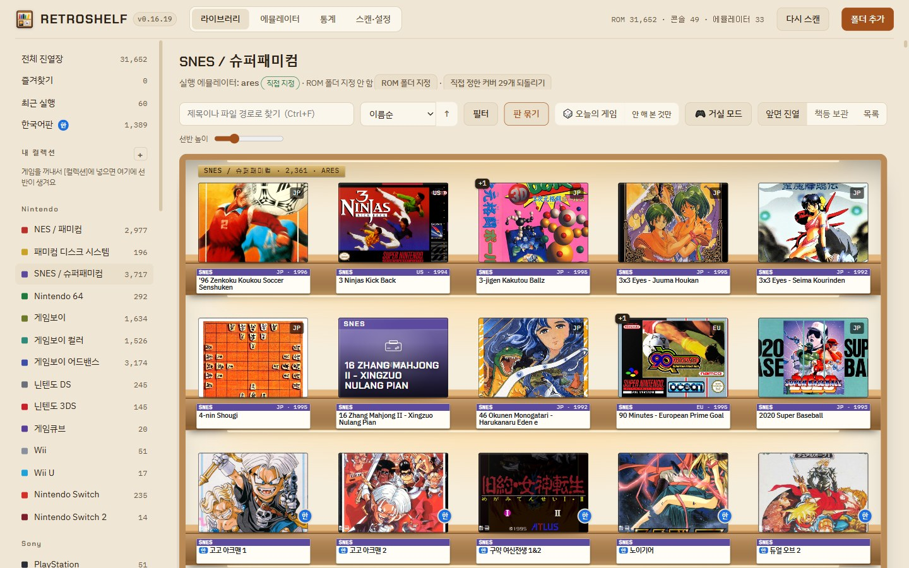

# RetroShelf (Rust · Tauri)



게임 케이스를 유리 진열장에 꽂아 두는 형태의 멀티 에뮬레이터 프론트엔드입니다. 폴더를 등록하면 에뮬레이터와 ROM을 찾아 콘솔별 선반에 진열하고, 콘솔마다 실행할 에뮬레이터를 자동으로 붙입니다.

Rust(Tauri 2)로 만들었습니다. 화면은 Windows에 들어 있는 WebView2로 그리기 때문에 실행 파일이 작고(약 5MB) 설치 없이 바로 뜹니다.

> 📖 **[자세한 사용 설명서 보기](docs/manual.md)** — 화면 구성, 게임 실행, 커버 그림, 에뮬레이터·스캔 설정, 기종별 기능, 문제 해결까지 실제 화면 그림과 함께 설명합니다.

## 실행

`RetroShelf.exe`와 `WebView2Loader.dll`을 **같은 폴더에 둔 채로** `RetroShelf.exe`를 실행하세요.

- Windows 10·11에는 보통 WebView2가 이미 들어 있습니다. "WebView2 Runtime을 찾을 수 없다"는 창이 뜨면 Microsoft의 WebView2 Runtime(Evergreen)을 설치하세요.
- 서명하지 않은 실행 파일이라 SmartScreen 경고가 뜨면 **추가 정보 → 실행**을 누르세요.
- 라이브러리, 커버, 실행 로그, 화면 캐시는 모두 `RetroShelf.exe` 옆의 `RetroShelfData` 폴더에 저장됩니다(포터블). 폴더째 다른 PC나 USB로 옮겨도 그대로 쓸 수 있고, 드라이브 문자가 바뀌면 경로를 자동으로 고칩니다. 실행 폴더에 쓸 수 없을 때(예: Program Files)만 사용자 AppData를 씁니다.

## 사용 방법

1. **폴더 추가**로 에뮬레이터와 ROM이 있는 폴더를 고릅니다. 상위 폴더 하나(예: `D:\Games`)만 골라도 하위 폴더까지 찾습니다.
2. 케이스를 누르면 꺼내서 열리고, 안의 디스크나 카트리지를 누르면 게임이 실행됩니다.
3. 게임을 끄면 플레이 시간이 기록됩니다.

| 동작 | 방법 |
| --- | --- |
| 바로 실행 | 선반의 케이스를 더블클릭 |
| 선반 이동 | 케이스에 포커스를 두고 방향키 |
| 검색 | Ctrl+F |
| 다시 스캔 | F5 |
| 케이스 닫기 | Esc |
| 거실 모드 켜기·끄기 | F11 (또는 도구 막대의 🎮 거실 모드) |

## 자동 인식 규칙

**에뮬레이터**: 실행 파일 이름으로 찾습니다. RetroArch, DuckStation, PCSX2, RPCS3, shadPS4(PS4 전용), Kyty(PS4·PS5, `--game 게임폴더`로 실행), Vita3K, Flycast, Redream, Supermodel, Cemu, Azahar, Lime3DS, Citra, Stella, openMSX, blueMSX, TeknoParrot, Dolphin, PPSSPP, Ryujinx, KenjiNX, Eden, Citron, yuzu 계열, Eglantine, Lichii, xemu, Cxbx-Reloaded, Xenia, mGBA, SameBoy, melonDS, DeSmuME, Mesen, FCEUX, Snes9x, bsnes, Project64, simple64, RMG(Rosalie's Mupen GUI), BlastEm, Kega Fusion, Mesen-S, VisualBoyAdvance-M, NO$GBA, Nestopia, puNES, ePSXe, fMSX, ares, Mednafen, MAME, FBNeo, BizHawk를 알아봅니다. 스캔 폴더 밖이라도 `C:\Program Files` 같은 기본 설치 위치에 있는 openMSX, blueMSX, Project64, Dolphin, PCSX2, PPSSPP 등은 찾아 줍니다. ares와 Kega Fusion은 실행 인수의 `{sys}` 자리에 기종 지정(`--system "Mega CD"`, `-scd` 등)이 들어갑니다. RetroArch는 `cores` 폴더의 `*_libretro.dll`로 돌릴 수 있는 콘솔을 판단합니다. 목록에 없는 프로그램도 쓸 수 있습니다.
- 에뮬레이터 탭의 콘솔 줄에서 **실행 파일 직접 지정**(또는 선택 상자의 **다른 실행 파일 직접 고르기…**)을 누르면, 고른 exe가 그 콘솔의 에뮬레이터가 됩니다.
- 게임 정보 창에서도 그 게임만 다른 exe로 실행하도록 고를 수 있습니다.
- 직접 지정한 에뮬레이터는 이름, 실행할 콘솔, 실행 인수를 바꿀 수 있습니다.

**ROM**
- 한 콘솔만 쓰는 확장자(`.sfc`, `.gba`, `.nds` 등)는 바로 분류합니다.
- `.iso .chd .cue .bin .zip .7z .m3u`처럼 여러 콘솔이 쓰는 확장자는 가장 가까운 폴더 이름(예: `PS2`, `Sony - PlayStation 2`, `Saturn`, `MAME`)으로 판단합니다.
- 그래도 모르면 **미분류** 선반에 둡니다.
- 폴더째 들어 있는 게임도 알아봅니다: PS3(`PS3_GAME\USRDIR\EBOOT.BIN`), PS4·PS5(`eboot.bin`, PS5는 폴더 이름으로 구분), Xbox(`default.xbe`), Xbox 360(`default.xex`), PS Vita(`.vpk`, `eboot.bin` 덤프 폴더, Vita3K에 이미 설치된 게임). PS3·PS4·PS5·Vita 게임은 `param.sfo`에서 실제 제목을 읽습니다. Switch와 Switch 2는 같은 `.nsp`·`.xci`를 쓰므로 폴더 이름(`Switch 2`, `NS2` 등)으로 구분합니다.
- `.cue`가 있는 폴더의 `.bin`은 건너뜁니다. `(Disc 1)`, `(Disc 2)`처럼 디스크 표기만 다른 파일만 한 게임으로 묶고, `.m3u`가 있으면 그것으로 실행합니다. 지역판·베타·리비전은 따로 진열하고 버전을 표시합니다.
- BIOS·펌웨어 파일은 게임이 아니므로 자동으로 뺍니다. `bios`·`firmware` 폴더 안의 파일, 이름에 `[BIOS]`·`BIOS`가 들어간 파일, 잘 알려진 BIOS 파일 이름(`SCPH1001`, `gba_bios`, `neogeo`, `naomi`, `awbios`, `syscard3`, `disksys`, `kick34005` 등)이 해당합니다. 스캔 기록에 뺀 개수가 나옵니다.
- PS4·PS5 게임 폴더는 `param.sfo`·`param.json`에서 제목과 종류를 읽습니다. PS4 패치(`CATEGORY` gp)와 추가 콘텐츠(`CATEGORY` ac), PS5는 `param.json`에 게임과 패치를 가를 확실한 항목이 없어 덤프 도구가 붙인 `-patch0`·`-ac` 폴더, 이름에 Update·DLC가 들어간 폴더는 게임이 아니므로 뺍니다. 게임 폴더 이름 끝의 `-app0`은 떼고 표시합니다.
- Switch 업데이트·DLC(타이틀 ID 끝이 `800`이거나 `000`이 아닌 것, `[UPD]`·`[DLC]`·Update 표기)와 Wii U 업데이트·DLC 폴더(`0005000e`, `0005000c`, 이름에 Update·DLC)는 게임이 아니므로 자동으로 뺍니다.

**커버**: 다음 순서로 찾습니다.
1. 직접 넣은 커버 이미지
2. 게임과 같은 이름의 이미지 (아래 폴더들), DuckStation·PCSX2의 `covers` 폴더(에뮬레이터 폴더 또는 `문서\DuckStation`, `문서\PCSX2`)에서 파일 이름·제목·시리얼(예: `SLUS-00594.jpg`)로 찾은 이미지
3. 인터넷에서 받은 박스아트 (아래 '박스아트 받기')
4. 롬 파일 안에 들어 있는 타이틀 이미지: NDS 아이콘, PSP ISO·CSO의 `ICON0.PNG`, PBP(EBOOT)의 ICON0, Wii U `meta\iconTex.tga` (`RetroShelfData\icons`에 PNG로 저장)
5. 모두 없으면 기기 색과 기기 모양 아이콘

 게임과 같은 이름의 이미지(`png`, `jpg`, `webp`)가 게임 폴더나 그 안의 `covers`, `boxart`, `media\covers`, `media\box2dfront` 폴더에 있으면 커버로 씁니다.

**실행 인수**: 에뮬레이터 탭에서 고칠 수 있습니다. 다음 값이 실제 경로로 바뀝니다.
- `{rom}`: 게임 파일
- `{core}`: RetroArch 코어
- `{dir}`: 게임 폴더
- `{name}`: 확장자를 뺀 파일 이름

## 기기 분류

실물 기기 기준으로 나눕니다. 왼쪽 목록은 제조사별로 묶여 있습니다.
- Nintendo: NES/패미컴, 패미컴 디스크 시스템, SNES, 버추얼 보이, N64, 게임보이, 게임보이 컬러, GBA, DS, 3DS(`.3ds` `.cci` `.cxi` `.3dsx`와 Azahar 압축 형식 `.zcci` `.zcxi` `.z3dsx`), 게임큐브, Wii, Wii U, Switch, Switch 2(`.nup`)
- Sony: PS1~PS5, PSP, PS Vita
- Sega: SG-1000, 마스터 시스템, 게임 기어, 메가드라이브, 메가 CD, 32X, 새턴, 드림캐스트, NAOMI, NAOMI 2, 아토미스웨이브, Model 2(Model 2 Emulator 또는 MAME), Model 3(Supermodel 또는 MAME). `vf2.zip`·`scud.zip` 같은 롬셋 이름을 실제 제목으로 표시
- NEC: PC엔진(HuCard), 슈퍼그래픽스, PC엔진 CD-ROM², PC-FX
- MSX: MSX, MSX2/MSX2+, MSX turbo R (`.rom`·`.dsk`·`.cas`는 폴더 이름으로 구분, `.mx1`·`.mx2`는 바로 분류)
- SNK: 네오지오 CD, 네오지오 포켓, 네오지오 포켓 컬러 / Bandai: 원더스완, 원더스완 컬러 / Atari: 2600, 7800, 링크스 / Microsoft: Xbox, Xbox 360
- 아케이드(MAME·FBNeo), PC 기반 아케이드(TeknoParrot: `UserProfiles` 폴더에 설정해 둔 게임을 `--profile=이름.xml`로 실행)

CD 기기(메가 CD, PC엔진 CD, 새턴 등)와 NAOMI·아토미스웨이브는 확장자가 겹치므로 폴더 이름(예: `Sega CD`, `PC Engine CD`, `NAOMI 2`, `Atomiswave`, `Model 3`)으로 구분합니다.

## 스캔에서 뺄 폴더

스캔·설정 탭의 **폴더 트리에서 여러 개 고르기**를 누르면 등록한 스캔 폴더 아래 하위 폴더가 트리로 펼쳐지고, 체크박스로 여러 폴더를 한 번에 골라 제외할 수 있습니다. 체크한 폴더와 그 아래 파일은 스캔하지 않습니다. 폴더 하나만 고를 때는 **폴더 하나 직접 추가**를 써도 됩니다. 상위 폴더 하나를 통째로 등록했을 때 원하지 않는 파일이 섞이는 것을 막을 수 있습니다.

## PC엔진 CD System Card (게임별)

PC엔진 CD 게임을 꺼내면 정보 창에서 그 게임을 어떤 System Card로 실행할지 고를 수 있습니다(예: 한글 패치 전용 System Card). **System Card 파일 추가…**로 파일을 고르면 다른 게임에서도 목록에 나옵니다.
- **Mednafen**: Mednafen의 게임별 설정 파일(`pgconfig\게임이름.pce.cfg`)에 `pce.cdbios`를 적습니다. Mednafen 전체 설정은 바뀌지 않습니다.
- **BizHawk**: 게임을 실행하는 동안만 `config.ini`의 `PCECD+Bios`를 고른 파일로 바꾸고, 게임을 끄면 원래 값으로 되돌립니다.
- 다른 에뮬레이터는 실행할 때 System Card를 바꿀 방법이 없어서 이 기능이 꺼져 있습니다.

## 한국어판

파일·폴더 이름에 한국어를 뜻하는 표기가 있으면 **한국어판**으로 봅니다. 정식 한국판인지 한글패치인지는 이름만으로 가릴 수 없어서 따로 나누지 않습니다.
- 알아보는 표기: `kor`, `korea`, `korean`, `T-Kor`, `(K)`, 언어 목록의 `Ko` (예: `(En,Ja,Ko)`), `한글`, `한국어`, `한국판`, `한패`
- 케이스에 파란 **한** 배지가 붙고, 정보 창에 "한국어판"이 표시됩니다.
- 왼쪽 목록에 **한국어판** 선반이 생기고, 필터의 **한국어판만**으로도 고를 수 있습니다.
- 판 묶기에서는 한국어판이 대표로 선반에 나옵니다.

## 파일 확인과 게임 정보

스캔이 끝나면 게임 정보를 맞춰 봅니다(스캔·설정 탭에서 끌 수 있음).
- 카트리지 롬(NES·SNES·N64·GB·GBA·DS·메가드라이브·PC엔진 등, 128MB 이하)은 파일 내용의 CRC32를 계산해 No-Intro 목록과 대조합니다. zip 안의 롬, NES·FDS·Lynx·7800 헤더와 SNES 복사기 헤더도 처리합니다. 계산 결과는 `RetroShelfData\meta\crc-cache.tsv`에 기억해 두고 바뀐 파일만 다시 읽습니다.
- 맞으면 파일 이름이 엉망이어도 정식 이름으로 보여 주고(한국어판은 파일 이름 그대로), 그 이름으로 박스아트를 다시 찾습니다. 목록에 없는 파일은 정보 창에 "목록에 없는 파일"이라고 표시합니다(해킹·번역·배드 덤프일 수 있음).
- 디스크 게임은 파일 이름 속 시리얼(예: `SCUS-94228`)이나 이름으로 Redump 목록과 맞춥니다.
- libretro-database에서 장르·발매연도·개발사·유통사를 받아 정보 창과 케이스 뒷면에 보여 줍니다. 장르 정보는 카트리지 콘솔이 풍부하고, 디스크 콘솔은 개발사 정도만 있습니다.
- 필터에 **장르**와 **연대**(80년대, 90년대 …) 칩이 생기고, 정렬에 **발매연도순**이 추가됩니다.

## 아케이드 원본·클론

아케이드 롬셋(`sf2.zip`, `sf2ua.zip` 같은 짧은 이름)은 스캔할 때 롬셋 목록과 맞춰 봅니다.
- 목록은 FBNeo의 DAT(아케이드·네오지오)를 GitHub에서 받아 `RetroShelfData\arcade`에 저장하고 30일마다 새로 받습니다. MAME가 등록되어 있으면 `mame -listfull`·`-listclones` 결과도 합칩니다(MAME 버전이 바뀔 때만 다시 읽음).
- 롬셋 이름 대신 실제 제목(예: Street Fighter II: The World Warrior)과 지역, 연도·제조사가 나옵니다.
- **판 묶기**가 켜져 있으면 원본(parent) 아래에 클론이 묶여 케이스 하나로 나옵니다. 대표는 원본입니다.
  - 정보 창에는 원본과 그 아래 클론이 계층으로 나오고, 클론을 누르면 그 판이 선반에 나옵니다.
  - 목록 보기에서는 원본 줄 왼쪽의 ▸를 누르거나(키보드 →) 펼쳐서 클론을 줄 아래에 볼 수 있습니다.
- 박스아트도 libretro의 MAME 목록에서 실제 제목으로 찾습니다. 클론 그림이 없으면 원본 그림을 씁니다.

## 플레이 통계

**통계** 탭에서 RetroShelf로 실행한 기록을 봅니다: 총 플레이 시간·이번 달·해 본 게임 비율, 월별 플레이 시간(최근 12개월), 콘솔별·장르별 플레이 시간, 많이 한 게임 10개, 최근 플레이 기록. 게임 이름을 누르면 진열장에서 그 게임을 꺼내 줍니다.

## 테마

스캔·설정 탭의 **테마**에서 기본(시스템)·원목·월넛·검은 유리·어두운 방·게임숍 중에서 고릅니다. 앱 전체의 바탕·패널·글자·강조색과 진열장의 선반 판·뒷벽·조명이 함께 바뀝니다. 기본은 윈도우의 밝은·어두운 모드를 따라갑니다. 모든 테마는 글자와 바탕의 명도 대비 4.5:1 이상으로 맞췄습니다.

## 지역판 묶기

같은 콘솔에서 제목이 같은 지역판·리비전·베타를 케이스 하나로 묶습니다(도구 막대의 **지역판 묶기**로 켜고 끔).
- 선반에는 대표 판 하나만 나오고, 케이스 왼쪽 위에 다른 판 개수(+2 등)가 붙습니다.
- 대표 판은 정식판 → 지역 우선순위 → 실행 가능 → 최근에 한 판 순으로 고릅니다. 지역 우선순위는 스캔·설정 탭에서 바꿀 수 있습니다(기본 KR › JP › US › EU › WW).
- 케이스를 꺼내면 정보 창에 모든 판이 나오고, 다른 판을 누르면 그 판으로 바뀌면서 앞으로 그 판이 선반에 나옵니다. 즐겨찾기·플레이 기록은 판마다 따로 남습니다.
- 필터는 묶기 전에 적용됩니다. 예를 들어 지역 필터를 JP로 두면 일본판이 대표로 나옵니다.

## 내 컬렉션

콘솔과 상관없이 직접 이름을 붙인 선반을 만들 수 있습니다.
- 왼쪽 목록 **내 컬렉션**의 **+** 또는 게임 정보 창의 **+ 새 컬렉션**으로 만들고, 정보 창의 컬렉션 버튼으로 게임을 넣고 뺍니다.
- 컬렉션 화면 위쪽에서 이름을 바꾸거나 컬렉션을 지울 수 있습니다. 컬렉션을 지워도 게임은 그대로입니다.

## 가격표

앞면 진열에서는 게임 가게 진열장처럼 선반 앞쪽 레일에 가격표 모양의 이름표가 끼워집니다. 위 띠에는 기기 이름(기기 색)과 지역·발매연도, 아래에는 게임 이름(두 줄까지)과 한국어판 표시가 나옵니다. 케이스를 들거나 꺼내도 가격표는 선반에 남습니다. 스캔·설정 탭의 **앞면 진열에 가격표 달기**로 끌 수 있습니다.

## 케이스 모양

- 카트리지는 콘솔마다 실제 카트리지의 실루엣을 본뜬 모양으로 그립니다(로고·상표는 그리지 않음): NES와 패미컴(일본판), 북미 SNES와 슈퍼패미컴(일본·유럽판), N64, 게임보이(오른쪽 위가 깎인 모양), GBA, DS·3DS·Switch·Vita 카드, 메가드라이브, 마스터 시스템, 게임 기어, 32X, PC엔진 HuCard, 아타리, 패미컴 디스크, 링크스, MSX, 네오지오 포켓, 원더스완, 버추얼 보이. 패미컴 카트리지 색은 게임마다 여러 가지입니다.
- 케이스 플라스틱 색도 실제 케이스를 따릅니다: PS2·게임큐브 검정, Wii 흰색, Wii U 연한 하늘색, Xbox 360 초록, PS3·PS4 파랑, PS5 흰색, Switch 빨강, 3DS 흰색 등.
- CD·DVD 게임은 디스크 라벨에 커버 그림을 인쇄한 것처럼 그립니다(가운데 구멍과 투명 고리는 그대로).

- 카트리지 라벨에는 커버 그림 전체가 라벨 크기에 맞춰 들어갑니다(남는 곳은 같은 그림을 흐리게 깔아 채움). 커버가 없으면 제목이 들어갑니다.
- 케이스 안의 취급설명서는 커버 그림이 잘리지 않고 다 들어갈 자리가 있을 때만 그림을 넣고, 자리가 모자라면(GBA·GB처럼 작은 케이스) 제목만 크게 씁니다.
- **케이스 애니메이션** 속도는 스캔·설정 탭에서 끄기·빠르게(기본)·보통·느리게 중에서 고릅니다. 끄면 케이스가 바로 열리고 닫힙니다.

## 케이스 뒷면

꺼낸 케이스의 **↻ 뒷면**(패드는 Y)을 누르면 케이스를 뒤집어 타이틀 화면·게임 화면 스크린샷과 플레이 횟수·총 시간·마지막 실행, 지역·크기·판 수를 보여 줍니다. 스크린샷은 처음 뒤집을 때 libretro-thumbnails에서 받아 `RetroShelfData\boxart`에 저장합니다.
- GBA·GB·DS처럼 작은 케이스는 스크린샷 대신 플레이 기록을 보여 줍니다: 플레이 횟수, 총 시간, 마지막·처음 플레이, 가장 길게 한 시간, 평균, 최근 플레이 날짜와 시간.
- 플레이 날짜별 기록은 0.12.0부터 쌓입니다(게임마다 최근 30번).

## 오늘의 게임

도구 막대의 **🎲 오늘의 게임**을 누르면 지금 보고 있는 선반(필터·검색 포함)에서 실행할 수 있는 게임 하나를 무작위로 골라 그 자리까지 스크롤한 뒤 꺼내 줍니다. **안 해 본 것만**을 켜면 한 번도 실행하지 않은 게임 중에서 고릅니다.

## 거실 모드 (패드)

**🎮 거실 모드**(F11)는 전체 화면에서 선반만 크게 보여 주고, 아래에 버튼 안내가 나옵니다. Xbox·DualSense 등 XInput/표준 패드를 쓸 수 있습니다(패드 Start로도 켜고 끔).

| 패드 | 선반에서 | 케이스를 꺼냈을 때 |
| --- | --- | --- |
| 방향키·왼쪽 스틱 | 케이스 이동 | ◀ ▶ 다른 판, ▲ ▼ 정보 창 스크롤 |
| A | 꺼내기 | 실행 |
| B | 거실 모드 나가기 | 닫기 (뒷면이면 앞면으로) |
| X | 즐겨찾기 | 즐겨찾기 |
| Y / Back | 오늘의 게임 | 뒷면 보기 |
| LB / RB | 이전·다음 선반 (전체, 즐겨찾기, 컬렉션, 콘솔) | — |
| Start | 거실 모드 켜기·끄기 | — |

게임이 실행 중일 때는 패드 입력이 에뮬레이터로만 가도록 RetroShelf는 패드를 무시합니다. 키보드로도 방향키·Enter·Esc로 똑같이 움직일 수 있습니다.

## 온라인에서 커버 찾기

게임을 꺼내서 **🔎 온라인에서 커버 찾기**를 누르면 커버를 직접 고를 수 있습니다.
- 제목으로 libretro-thumbnails 목록을 검색해 그림을 늘어놓습니다. 박스아트·타이틀 화면·게임 화면 중에서 고를 수 있고, 다른 콘솔 목록으로 바꿔 찾을 수도 있습니다.
- 그림을 누르면 그 게임의 커버가 됩니다(`RetroShelfData\boxart`에 저장). **기본 커버로**를 누르면 되돌립니다.
- **웹 이미지 검색** 탭은 앱 안에서 바로 웹 이미지를 검색해 같은 칸에 늘어놓습니다(DuckDuckGo, 한 번 더 시도해도 안 되면 Bing). Bing으로 넘어가면 결과 위에 DuckDuckGo가 실패한 이유(예: `403 오류`, `토큰을 찾지 못함`)를 보여 주고, **DuckDuckGo로 다시 시도** 버튼으로 Bing 없이 다시 찾을 수 있습니다. DuckDuckGo는 직접 요청을 봇으로 보고 막는 일(202 응답)이 많아서, 앱 안의 숨은 브라우저 창(WebView2)으로 DuckDuckGo 이미지 페이지를 열어 결과를 받아 옵니다. 그게 안 되면 직접 요청(Windows 자체 TLS)을 한 번 더 시도합니다. 그림을 누르면 원본을 받아 커버로 정하고, 원본 사이트가 막으면 미리보기 그림으로 정합니다. libretro 목록에 맞는 그림이 없으면 자동으로 이 탭으로 넘어갑니다. 공식 API가 아니라 검색 사이트가 바뀌면 동작하지 않을 수 있습니다.
- **브라우저로 찾기**의 **구글 이미지**·**DuckDuckGo 이미지**는 기본 브라우저를 새 창으로 엽니다. 찾은 이미지 주소를 붙여 넣어 **주소로 넣기**를 누르면 됩니다. **파일에서 고르기**도 그대로 있습니다.

## 롬 파일 속 아이콘 (3DS·Switch)

- **3DS**: CIA, 복호화된 .3ds/.cci/.cxi, .3dsx에서 48×48 아이콘(SMDH)을 꺼냅니다. 암호화된 .3ds/.cci는 키 없이 읽을 수 없어 건너뜁니다.
- **Switch**: NSP·XCI 안의 control NCA에서 아이콘(256×256 JPEG)을 꺼냅니다. NCA가 암호화되어 있어 에뮬레이터가 쓰는 `prod.keys`가 필요합니다. Eden·yuzu·Ryujinx 등 등록된 에뮬레이터 폴더(`user\keys`, `portable\system` 등)와 AppData에서 자동으로 찾고, 없으면 스캔·설정 탭에서 직접 지정할 수 있습니다. 키는 복호화에만 쓰고 어디로도 보내지 않습니다. NSZ·XCZ(압축)도 됩니다. 아이콘을 못 꺼낸 Switch 게임은 실행할 때마다 다시 시도하고(키를 바꿨을 수 있어서), 게임에 필요한 키가 prod.keys에 없으면 어떤 키가 빠졌는지 로그에 적습니다.

### 안 쓰는 그림 정리
게임이 목록에서 빠지거나 커버를 기본으로 되돌리면, 어떤 게임도 쓰지 않는 그림(`RetroShelfData`의 `boxart`·`covers`·`icons`)을 자동으로 지웁니다. 연결이 끊긴 드라이브의 게임은 목록에 남아 있으므로 그림도 남습니다.
- 꺼낸 아이콘은 커버가 없을 때 케이스 앞면·설명서·카트리지 라벨에 쓰입니다.

## 박스아트 받기

커버가 없는 게임은 스캔이 끝난 뒤 [libretro-thumbnails](https://github.com/libretro-thumbnails/libretro-thumbnails)에서 박스아트를 받습니다(스캔·설정 탭에서 끌 수 있음).
- 찾는 순서: 롬 파일 이름 그대로 → 디스크 표기를 뺀 이름 → 파일 내용(CRC)으로 찾은 정식 이름 → 제목이 같은 이름 → 제목 낱말이 많이 겹치는 이름.
- 제목 비교는 괄호 표기·관사·기호를 빼고, 로마 숫자와 아라비아 숫자를 같게 봅니다(`Zelda 2` ↔ `Zelda II - The Adventure of Link`). 속편 번호가 다르면 다른 게임으로 봅니다. 낱말 비교로 찾은 박스아트는 정보 창에 "비슷한 제목으로 찾은 박스아트"라고 표시됩니다.
- 같은 제목의 그림이 여럿이면 지역이 맞는 것, No-Intro식 이름을 고르고, 베타·프로토·해킹·배드 덤프·모음집 재발매판은 뒤로 미룹니다.
- 박스아트 목록 서버(thumbnails.libretro.com·GitHub API)에 연결하지 못하면 libretro-database의 정식 이름 목록을 후보로 대신 씁니다.
- 받은 이미지는 `RetroShelfData\boxart`에 저장되어 인터넷 없이도 계속 보입니다. 박스아트 목록은 30일마다 새로 받습니다.
- 못 찾은 게임은 다시 찾지 않습니다. 파일 이름을 고친 뒤 **못 찾은 게임 다시 찾기**를 누르면 됩니다.
- PS5·Switch(목록 없음)는 받지 않습니다. PS4는 목록에 있는 게임이 적습니다. 아케이드는 롬셋 목록에서 찾은 실제 제목으로 찾습니다.

## PC-98 (Neko Project)

- `.hdi .fdi .d88 .hdm .nfd .nhd .thd .fdd .tfd .d98` 이미지를 PC-9801 / PC-9821로 분류합니다. `PC-98`, `PC9801`, `PC9821` 같은 이름의 폴더에 넣어 두면 확실합니다.
- Neko Project 계열(`np2`, `np21`, `np21w`, `np21x64w`, `np2nt`, `np2kai`, `sdlnp21kai` …)을 찾아 자동 연결합니다. RetroArch의 `np2kai` 코어도 씁니다.
- 실행: 플로피 이미지는 `np21x64w.exe "디스크1" "디스크2"`처럼 명령줄로 넘겨 FDD1·FDD2에 넣습니다. Neko Project는 명령줄 이미지를 모두 플로피로 넣기 때문에, 하드디스크 이미지(`.hdi .nhd .thd .hdd .vhd`)는 실행 직전에 ini의 `HDD1FILE=`(둘째는 `HDD2FILE=`)에 적고, 지난번 플로피(`FDD1FILE`·`FDD2FILE`)는 비워서 하드디스크로 부팅하게 합니다. 바꾼 값은 그 설정이 필요 없는 게임을 실행할 때 원래대로 되돌립니다. ini 값은 Windows 시스템 코드 페이지(ANSI)로 적어서 한글·일본어 경로도 그대로 씁니다.
- `(Disk A)` `(Disk B)` `(Disk 1 of 3)` `[Disk2]` 같은 이름의 여러 장짜리는 한 게임으로 묶습니다. 세 장째부터는 에뮬레이터 메뉴에서 바꿔 넣어 주세요.
- 박스아트는 libretro의 `NEC - PC-98` 목록에서 찾습니다.
- **폰트 BMP (게임별)**: PC-98 게임 정보 창의 **폰트 BMP**에서 게임마다 폰트를 고릅니다. 에뮬레이터 폴더와 그 안 `Font` 폴더의 BMP가 목록에 나오고, 다른 파일도 고를 수 있습니다. 에뮬레이터 탭에서 정한 **기본 폰트**는 게임별로 정하지 않은 게임에 씁니다. 실행할 때 exe 옆 ini(예: `np21x64w.ini`)의 `fontfile=`에 적고, 폰트를 정하지 않은 게임을 실행할 때는 처음 값으로 되돌립니다. 경로에 영문이 아닌 글자가 있으면 폰트를 에뮬레이터 폴더에 `retroshelf_font.bmp`로 복사해서 씁니다.
- Neko Project는 zip을 바로 열지 못하므로 압축을 풀어 두세요(정보 창에도 안내가 나옵니다).

## Cemu 그래픽 팩 (Wii U)

Wii U 게임을 Cemu로 실행하도록 정해 두면, 게임 정보 창에 **그래픽 팩** 목록이 나옵니다.
- 게임의 타이틀 ID를 `.wua` 안의 폴더 이름이나 압축 푼 폴더의 `meta\meta.xml`에서 읽고(그 밖의 형식은 파일 이름의 `[0005000…]`), Cemu `graphicPacks` 폴더의 팩 중 이 게임에 맞는 것만 보여 줍니다.
- 체크하면 켜지고, 해상도·FPS 같은 프리셋은 목록에서 고릅니다. 바꾸는 즉시 Cemu `settings.xml`의 `<GraphicPack>`에 저장되고, 다른 설정은 건드리지 않습니다. 처음 고칠 때 원래 파일을 `settings.xml.retroshelf.bak`으로 남겨 둡니다.
- Cemu 사용자 폴더는 exe 옆 `portable` → exe 옆 `settings.xml` → `%APPDATA%\Cemu` 순으로 찾습니다.
- Cemu가 켜져 있을 때는 바꿀 수 없습니다(닫힐 때 Cemu가 설정을 덮어씁니다). 그래픽 팩이 없으면 Cemu의 옵션 → 그래픽 팩 → 최신 그래픽 팩 다운로드를 먼저 해 주세요.

## Sega Model 1·Model 2

`Model 2`·`Sega Model 2`·`m2emulator` 같은 이름의 폴더에 있는 `.zip`을 Model 2 게임으로, `Model 1` 폴더의 `.zip`을 Model 1 게임으로 분류하고, `vf2`·`daytona`·`hotd` 같은 롬셋 이름을 실제 제목으로 보여 줍니다.

### sm2-emu (권장)
- 스캔 폴더 안에 `sm2-emu.exe`가 있으면 Model 2와 Model 1 게임에 자동으로 연결합니다(스캔 폴더 밖이면 에뮬레이터 탭에서 **실행 파일 바꾸기**로 지정).
- 실행할 때 롬 zip의 전체 경로를 넘깁니다: `sm2-emu.exe "D:\ROMs\Model 2\vf2.zip"` (작업 폴더는 sm2-emu 폴더). 기본 실행 인수는 `"{rom}"`이고, 에뮬레이터 탭에서 `--fullscreen "{rom}"`처럼 옵션을 붙일 수 있습니다.
- 클론(`vf2b`, `doaa` 등)은 부모 롬(`vf2.zip`, `doa.zip`)이 같은 폴더에 있어야 합니다.
- sm2-emu 폴더의 `games.xml`을 읽어 제목·버전·연도·제조사를 채우고, 보드가 `model1`인 게임은 Model 1 칸으로 옮깁니다. 클론은 부모 게임 아래로 묶입니다.

### ElSemi Model 2 Emulator
`Model 2`·`Sega Model 2`·`m2emulator` 같은 이름의 폴더에 있는 `.zip`을 Model 2 게임으로 분류하고, `vf2`·`daytona`·`hotd` 같은 롬셋 이름을 실제 제목으로 보여 줍니다.
- 에뮬레이터는 ElSemi의 Model 2 Emulator(`emulator_multicpu.exe`, 없으면 `emulator.exe`)를 씁니다. exe 이름이 흔해서 폴더 이름에 Model 2·m2emulator가 들어 있을 때만 인식합니다. 없으면 MAME로 실행합니다.
- Model 2 Emulator는 롬셋 이름만 받고 `EMULATOR.INI`의 `[RomDirs]`에 적힌 폴더에서 게임을 찾습니다. 게임 폴더가 거기 없으면 정보 창에 안내가 나오고, **Model 2 Emulator ROM 폴더에 추가**를 누르면 `EMULATOR.INI`에 그 폴더를 넣습니다(원래 파일은 `.bak`으로 남김).

## 에뮬레이터 실행 파일 바꾸기

에뮬레이터 탭의 카드마다 **실행 파일 바꾸기** 버튼이 있습니다. 자동으로 찾은 에뮬레이터도 다른 실행 파일(예: 런처 대신 본체 `shadps4.exe`, 다른 버전 폴더의 exe)로 바꿀 수 있고, 다시 스캔해도 유지됩니다. 카드에는 "실행 파일 직접 지정" 표시와 자동으로 찾았던 파일 경로가 함께 나오고, **자동으로 되돌리기**로 원래대로 돌릴 수 있습니다.

## 실행 실패 알림

에뮬레이터가 3초 안에 꺼지거나, 20초 안에 오류 코드로 꺼지면 알림 창이 뜹니다.
- 에뮬레이터 로그에서 오류로 보이는 줄(빨간색)과 마지막 몇 줄을 보여 줍니다.
- 실행 인수, BIOS·키 파일, 그래픽 드라이버, 파일 경로 문제로 보이면 그에 맞는 안내를 덧붙입니다.
- **로그 파일 열기**, **명령 복사**, **실행 인수 고치기**(에뮬레이터 탭으로 이동) 버튼이 있습니다.

## 콘솔별 ROM 폴더

스캔·설정 탭의 **콘솔별 ROM 폴더**에서 콘솔을 고르고 폴더를 추가합니다. 라이브러리에서 콘솔을 고른 화면의 머리말에서도 추가할 수 있습니다.
- 폴더를 지정한 콘솔은 **그 폴더 안의 게임만** 진열합니다. 다른 곳에서 찾은 같은 콘솔 게임은 숨기고, 숨긴 개수를 스캔 기록에 적습니다.
- 지정한 폴더 안의 게임은 폴더 이름과 상관없이 그 콘솔로 분류합니다.
- 폴더마다 **하위 폴더 포함** 체크 상자가 있습니다. 끄면 그 폴더 바로 아래 파일만 스캔합니다.
- 폴더를 지정하지 않은 콘솔은 전처럼 등록한 스캔 폴더 전체에서 찾습니다.

## 목록 정렬과 필터

- **목록** 보기에서 제목·콘솔·지역·에뮬레이터·플레이 머리글을 누르면 그 기준으로 정렬하고, 한 번 더 누르면 순서가 뒤집힙니다(▲ 오름차순, ▼ 내림차순).
- 정렬 선택 상자 옆 화살표 버튼으로도 방향을 바꿀 수 있습니다. 최근 실행순·크기순 정렬도 있습니다.
- **필터** 버튼을 누르면 필터 막대가 열립니다. 지역(JP·US·EU·KR·WW·기타, 여러 개 고르면 그중 하나라도 맞는 게임)과 조건(한국어판만, 정식판만, 실행 가능한 것만, 커버 있는 것만, 커버 없는 것만, 플레이한 것만, 안 해 본 것만)을 고를 수 있고, 몇 개가 표시되는지 나옵니다.
- 필터는 진열장 보기와 검색에도 함께 적용되며, 다음에 켤 때도 유지됩니다.

## 에뮬레이터별 ROM 폴더

에뮬레이터 탭의 각 에뮬레이터 카드에서 **ROM 폴더 추가**로 폴더를 지정할 수 있습니다.
- 그 폴더의 게임은 폴더 이름과 상관없이 그 에뮬레이터가 돌리는 기기로 분류되고, 그 에뮬레이터로 실행됩니다.
- 에뮬레이터 폴더 안에 있는 폴더(예: RetroArch의 `roms`)도 지정할 수 있습니다.
- 게임 정보 창에서 게임마다 다른 에뮬레이터를 고르면 그 선택이 우선합니다.

## FBNeo IPS 패치

FBNeo로 실행하는 게임을 꺼내면 정보 창에 그 게임의 IPS 패치 목록이 나옵니다.
- FBNeo의 IPS 폴더(기본 `support\ips\게임이름\`)에 있는 `.dat` 파일을 읽고, 파일 안의 설명을 한국어 → 영어 → 일본어 → 중국어 순서로 보여 줍니다.
- 체크한 패치는 `-ips 패치1.dat,패치2.dat`로 넘겨서 적용한 채로 실행합니다. 게임마다 고른 패치를 기억합니다.
- 처음에는 FBNeo에서 마지막으로 켜 둔 패치(`config\ips\게임이름.ini`)가 체크된 상태로 나옵니다.

## 에뮬레이터 설정

RetroShelf는 에뮬레이터를 그 에뮬레이터 폴더에서 실행하고, 전체화면·해상도 같은 설정을 덮어쓰는 인수는 넣지 않습니다. 그래서 에뮬레이터를 직접 켰을 때의 설정이 그대로 쓰입니다.
- DuckStation·PCSX2의 `-batch`, Dolphin의 `-b`, RPCS3의 `--no-gui`는 게임을 끄면 에뮬레이터도 닫히게 하는 옵션입니다(플레이 시간 기록용).
- MAME는 `mame.ini`의 `rompath`를 읽어서 게임 폴더 뒤에 붙입니다. 원래 ROM 경로(BIOS 등)도 그대로 쓰입니다.
- FBNeo 단독판은 파일 경로 대신 게임 이름(예: `sf2`)만 받고, FBNeo에 등록된 ROM 폴더에서 게임을 찾습니다. 게임 폴더가 등록돼 있지 않으면 정보 창에 **FBNeo ROM 경로에 추가** 버튼이 나옵니다. 누르면 FBNeo 설정 파일에 그 폴더를 넣고, 원래 파일은 `.ini.bak`으로 남깁니다.
- 에뮬레이터가 게임을 열지 못하고 바로 닫히면 알려 주고, 에뮬레이터가 남긴 출력을 `RetroShelfData\logs`에 저장합니다.

## 많은 ROM

ROM이 수만 개여도 화면에 보이는 선반만 그리기 때문에 바로 뜹니다. 시작할 때 하는 다시 스캔은 뒤에서 진행되고, 그동안 저장된 진열장을 바로 쓸 수 있습니다.

## 직접 빌드 (Windows)

[Rust](https://rustup.rs)를 설치한 뒤:

```powershell
cargo install tauri-cli --version "^2" --locked
cd src-tauri
cargo tauri dev      # 개발 모드
cargo tauri build    # target\release\retroshelf.exe 와 bundle\nsis\ 설치 파일 생성
```

Windows의 기본(MSVC) 빌드는 WebView2 로더가 실행 파일 안에 들어가므로 `WebView2Loader.dll`이 따로 필요 없습니다. GitHub에 올리면 `.github/workflows/build.yml`이 `v*` 태그를 붙일 때 자동으로 빌드합니다.

## 파일 구성

| 파일 | 역할 |
| --- | --- |
| `src-tauri/src/main.rs` | 폴더 스캔, 에뮬레이터 실행·종료 감지, 저장, 대화상자 |
| `src-tauri/tauri.conf.json` | 창 크기, 보안 정책, 번들 설정 |
| `src/bridge.js` | 화면과 Rust 명령 연결 |
| `src/data.js` | 콘솔·에뮬레이터 정의, 파일 분류 규칙 |
| `src/app.js` | 진열장 화면과 동작 |
| `src/styles.css` | 진열장·케이스·디스크 디자인 |
| `src/carts.js` | 카트리지·플로피 모양(SVG) |
| `src-tauri/src/thumbs.rs` | 박스아트 목록·받기, 웹 이미지 검색 |
| `src-tauri/src/meta.rs` | CRC 계산, libretro-database 게임 정보 |
| `src-tauri/src/arcade.rs` | MAME·FBNeo 원본·클론 |
| `src-tauri/src/icons.rs`, `nxicon.rs` | 롬 속 아이콘 (NDS·3DS·Switch 등) |
| `src-tauri/src/cemu.rs` | Cemu 그래픽 팩 |
| `docs/manual.md`, `docs/images/` | 사용 설명서와 화면 그림 |
| `HANDOVER.md` | 개발 인계 문서 (구조·동작 흐름·확인 안 된 것) |
| `CHANGELOG.md` | 버전별 바뀐 점 |
| `dev/` | 시험용 스크립트 (화면 시험 틀, Switch 시험 파일 만들기) |


## BizHawk PC엔진 코어

에뮬레이터 탭의 BizHawk 카드에서 **PC엔진 코어**(TurboNyma·HyperNyma·PCEHawk)를 고르면, PC엔진·슈퍼그래픽스·CD-ROM² 게임을 BizHawk로 실행할 때 `config.ini`의 `PreferredCores`(PCE·PCECD·SGX·SGXCD)에 적습니다. 처음 고칠 때 `config.ini.bak`으로 백업합니다.
