# RetroShelf 사용 설명서

> 이 설명서는 **RetroShelf 0.16.20**를 기준으로 썼습니다. 화면 그림은 실제 라이브러리(게임 약 3만 개)에서 찍었고, 그림 속 폴더 경로는 예시 경로(`D:\Games\…`)로 바꿔 두었습니다.

RetroShelf는 여러 에뮬레이터와 게임 롬을 한곳에 모아, 게임 가게 진열장처럼 케이스를 꽂아 두고 꺼내서 실행하는 Windows용 프로그램입니다. 폴더만 등록하면 에뮬레이터와 롬을 스스로 찾아 콘솔별 선반에 진열하고, 콘솔마다 알맞은 에뮬레이터를 자동으로 붙여 줍니다.

---

## 목차

1. [시작하기](#1-시작하기)
2. [화면 구성](#2-화면-구성)
3. [진열장 둘러보기](#3-진열장-둘러보기)
4. [게임 꺼내기와 실행](#4-게임-꺼내기와-실행)
5. [커버 그림](#5-커버-그림)
6. [내 컬렉션](#6-내-컬렉션)
7. [거실 모드 (패드)](#7-거실-모드-패드)
8. [플레이 통계](#8-플레이-통계)
9. [에뮬레이터 탭](#9-에뮬레이터-탭)
10. [스캔·설정 탭](#10-스캔설정-탭)
11. [기종별 기능](#11-기종별-기능)
12. [한국어판 표시](#12-한국어판-표시)
13. [테마와 애니메이션](#13-테마와-애니메이션)
14. [데이터 폴더와 백업](#14-데이터-폴더와-백업)
15. [단축키 모음](#15-단축키-모음)
16. [문제 해결](#16-문제-해결)
17. [지원 기종과 에뮬레이터](#17-지원-기종과-에뮬레이터)

---

## 1. 시작하기

### 1.1 준비물

| 항목 | 설명 |
|---|---|
| 운영체제 | Windows 10 또는 11 (64비트) |
| WebView2 Runtime | 화면을 그리는 데 씁니다. Windows 10·11에는 대부분 이미 들어 있습니다. |
| 에뮬레이터 | RetroArch, DuckStation, PCSX2, Dolphin, Mesen, ares 등. RetroShelf는 에뮬레이터를 **실행만** 하고 따로 들어 있지 않습니다. |
| 게임 롬 | 직접 가지고 있는 게임의 롬·디스크 이미지 |

> RetroShelf는 에뮬레이터나 게임, BIOS 파일을 제공하지 않습니다. 에뮬레이터마다 필요한 BIOS·키 파일은 에뮬레이터 쪽에 먼저 넣어 두세요.

### 1.2 설치와 실행

설치 과정은 없습니다. 받은 파일을 원하는 폴더에 풀고 `RetroShelf.exe`를 실행하세요.

- `RetroShelf.exe` 옆에 `WebView2Loader.dll`이 함께 있으면 **같은 폴더에 둔 채로** 실행합니다.
- "WebView2 Runtime을 찾을 수 없다"는 창이 뜨면 Microsoft의 WebView2 Runtime(Evergreen)을 설치하세요.
- 서명하지 않은 실행 파일이라 SmartScreen 경고가 뜰 수 있습니다. **추가 정보 → 실행**을 누르세요.
- 설치판(`RetroShelf_x.y.z_x64-setup.exe`)을 쓰면 시작 메뉴에 등록됩니다. 데이터 저장 위치는 [14장](#14-데이터-폴더와-백업)을 보세요.

새 버전으로 바꿀 때는 `RetroShelf.exe`만 새 파일로 덮어쓰면 됩니다. 옆의 `RetroShelfData` 폴더는 그대로 두세요.

### 1.3 처음 실행

처음 실행하면 진열장이 비어 있습니다.

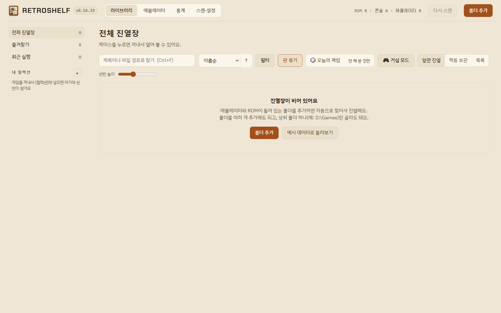

- **폴더 추가**: 에뮬레이터와 롬이 들어 있는 폴더를 고릅니다. 상위 폴더 하나(예: `D:\Games`)만 골라도 하위 폴더를 모두 찾아봅니다. 여러 번 눌러 폴더를 여러 개 등록해도 됩니다.
- **예시 데이터로 둘러보기**: 가짜 게임 목록으로 화면을 미리 둘러봅니다. 실제 폴더를 추가하면 예시 데이터는 사라집니다.

폴더를 추가하면 바로 스캔이 시작됩니다. 스캔이 끝나면 아래 일이 차례로 진행됩니다. 진행 상황은 화면 위쪽 상태 줄에 나옵니다.

1. 롬과 에뮬레이터 분류, 콘솔별 에뮬레이터 자동 지정
2. 롬 파일 속 아이콘 꺼내기 (3DS·Switch·NDS 등)
3. 파일 내용(CRC)으로 게임 확인, 장르·발매연도 받기
4. 커버가 없는 게임의 박스아트 받기

2~4번은 인터넷을 쓰고 시간이 걸리지만, 그동안에도 진열장은 그대로 쓸 수 있습니다.

### 1.4 권장 폴더 구성

RetroShelf는 **확장자**와 **폴더 이름**으로 콘솔을 알아봅니다. `.sfc`, `.gba`처럼 한 콘솔만 쓰는 확장자는 어디에 있어도 되지만, `.iso`, `.chd`, `.cue`, `.zip`처럼 여러 콘솔이 쓰는 확장자는 **가장 가까운 폴더 이름**으로 판단합니다. 그래서 콘솔별로 폴더를 나눠 두면 가장 정확합니다.

```
D:\Games\
├─ RetroArch-Win64\        ← 에뮬레이터 (실행 파일 이름으로 알아봄)
├─ Duckstation\
├─ PCSX2\
└─ Roms\
   ├─ SNES\               ← .sfc .smc .zip
   ├─ PS1\                ← .chd .cue/.bin .m3u
   ├─ PS2\                ← .iso .chd
   ├─ Saturn\
   ├─ PC Engine CD\
   ├─ arcade\             ← MAME·FBNeo 롬셋 (.zip)
   └─ PC-98\
```

폴더 이름은 `PS2`, `Sony - PlayStation 2`, `Saturn`, `Sega CD`, `PC Engine CD`, `MAME`처럼 흔히 쓰는 이름을 대부분 알아봅니다. 콘솔을 확실히 정하고 싶으면 [콘솔별 ROM 폴더](#103-콘솔별-rom-폴더)를 지정하세요.

---

## 2. 화면 구성

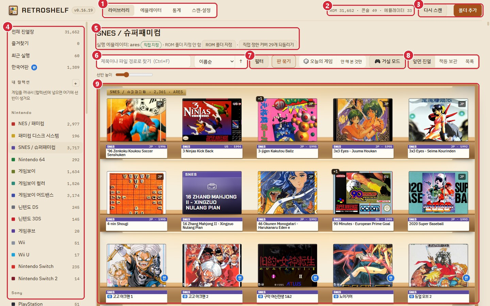

| 번호 | 이름 | 설명 |
|:-:|---|---|
| 1 | 탭 | **라이브러리**(진열장), **에뮬레이터**, **통계**, **스캔·설정** 화면으로 바꿉니다. |
| 2 | 상태 | 진열한 롬 수, 콘솔 수, 찾은 에뮬레이터 수. 게임을 실행 중이면 "실행 중"이 함께 나옵니다. |
| 3 | 다시 스캔 · 폴더 추가 | 등록한 폴더를 모두 다시 스캔하거나(F5) 새 폴더를 추가합니다. |
| 4 | 선반 목록 (사이드바) | 전체 진열장, 즐겨찾기, 최근 실행, 한국어판, 내 컬렉션, 그리고 제조사별 콘솔 선반. 오른쪽 숫자는 게임 수입니다. |
| 5 | 선반 머리말 | 고른 선반의 이름과 실행 에뮬레이터, ROM 폴더 지정, 직접 정한 커버 되돌리기 같은 콘솔별 도구가 나옵니다. |
| 6 | 검색 · 정렬 | 제목이나 파일 경로로 찾고(Ctrl+F), 정렬 기준과 방향(↑↓)을 바꿉니다. |
| 7 | 필터 · 판 묶기 · 오늘의 게임 · 거실 모드 | 조건으로 거르기, 지역판 묶기 켜고 끄기, 무작위 게임 고르기, 패드용 전체 화면. |
| 8 | 보기 | **앞면 진열**, **책등 보관**, **목록** 중에서 고릅니다. |
| 9 | 진열장 | 게임 케이스가 꽂힌 선반. 케이스를 누르면 꺼내서 엽니다. |

검색창 아래의 **선반 높이** 막대로 케이스 크기를 바꿀 수 있습니다. 줄이면 한 줄에 더 많은 케이스가 들어갑니다.

라이브러리 위쪽의 검색·정렬·필터·보기 줄은 아래로 내려도 그 자리에 고정되어, 언제든 바로 검색하고 필터를 바꿀 수 있습니다.

---

## 3. 진열장 둘러보기

### 3.1 선반 고르기

왼쪽 목록에서 선반을 고릅니다.

| 선반 | 내용 |
|---|---|
| 전체 진열장 | 모든 게임. 콘솔별로 구역이 나뉘어 이어집니다. |
| 즐겨찾기 | ☆ 즐겨찾기로 표시한 게임 |
| 최근 실행 | RetroShelf로 실행한 적이 있는 게임 (최근 순) |
| 한국어판 | 한국어판으로 알아본 게임 ([12장](#12-한국어판-표시)) |
| 내 컬렉션 | 직접 만든 선반 ([6장](#6-내-컬렉션)) |
| 콘솔 선반 | Nintendo, Sony, Sega, NEC, MSX, SNK, Bandai, Atari, Microsoft, 아케이드 순으로 제조사별로 묶여 있습니다. |
| 미분류 | 콘솔을 판단하지 못한 파일. 폴더 이름을 고치거나 콘솔별 ROM 폴더를 지정하면 제자리로 갑니다. |

게임이 하나도 없는 콘솔은 목록에 나오지 않습니다.

### 3.2 보기 세 가지

**앞면 진열** — 케이스 앞면(커버)이 보이게 꽂습니다. 케이스 아래 선반 레일에는 가격표 모양의 이름표가 붙습니다.

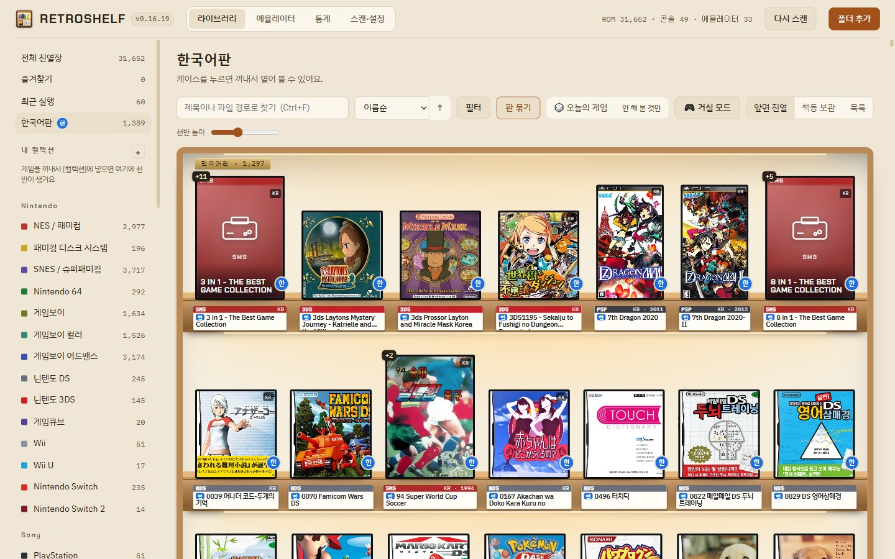

- 케이스 오른쪽 위: 지역(JP, US, EU, KR …)
- 케이스 왼쪽 위의 `+1`, `+2`: 같은 게임의 다른 판 수 ([3.6 지역판 묶기](#36-지역판-묶기))
- 파란 **한** 배지: 한국어판
- 가격표: 위 띠에 기기 이름(기기 색)과 지역·발매연도, 아래에 게임 이름(두 줄까지)

**책등 보관** — 케이스를 옆으로 세워 책등만 보이게 꽂습니다. 한 화면에 훨씬 많은 게임이 보입니다.

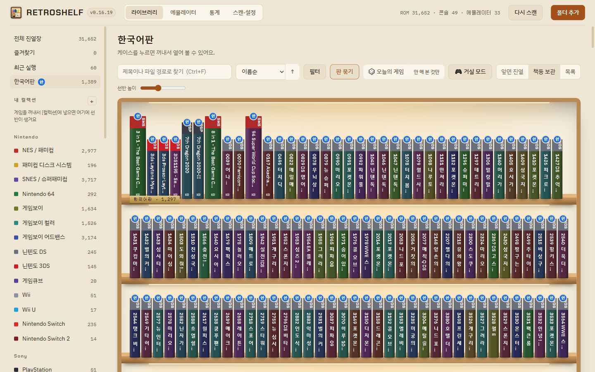

**목록** — 표 형식입니다. 제목·콘솔·지역·에뮬레이터·플레이 머리글을 누르면 그 기준으로 정렬하고, 한 번 더 누르면 순서가 뒤집힙니다(▲ 오름차순, ▼ 내림차순). 다른 판이 있는 게임은 `▸`를 눌러(키보드 →) 아래에 펼칠 수 있습니다.

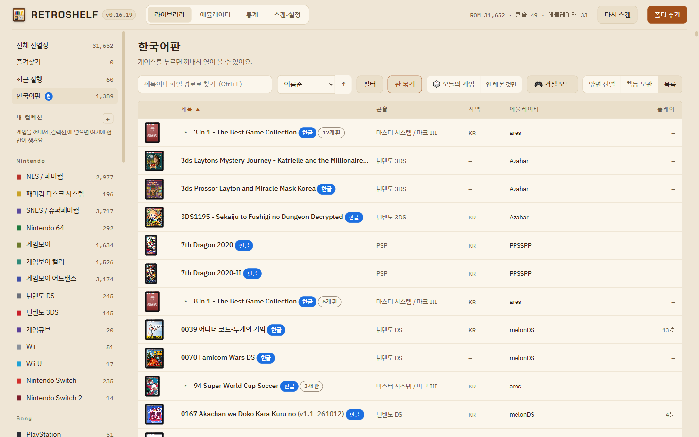

> 게임이 수만 개여도 화면에 보이는 선반만 그리기 때문에 바로 뜹니다.

### 3.3 검색

검색창(Ctrl+F)에 낱말을 넣으면 제목과 파일 경로에서 찾습니다. 지금 고른 선반 안에서 찾으므로, 모든 게임에서 찾으려면 **전체 진열장**을 고른 뒤 검색하세요.

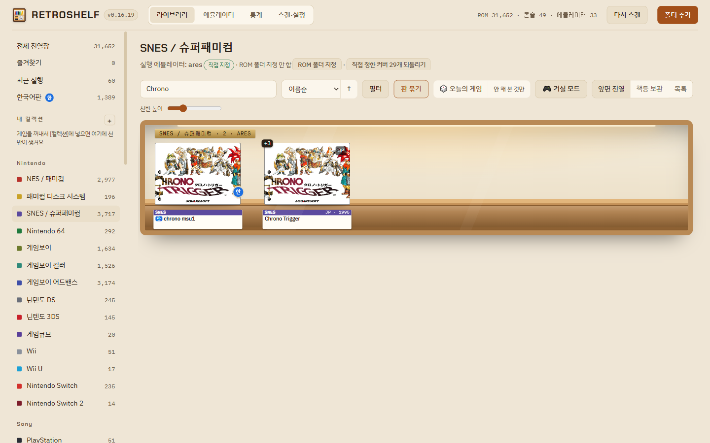

### 3.4 정렬

정렬 상자에서 기준을 고르고, 옆의 화살표 버튼으로 방향을 바꿉니다.

| 정렬 | 기본 방향 |
|---|---|
| 이름순 | 가나다·ABC순 |
| 최근 실행순 | 최근에 한 게임 먼저 |
| 플레이 시간순 | 오래 한 게임 먼저 |
| 크기순 | 큰 파일 먼저 |
| 발매연도순 | 오래된 게임 먼저 (게임 정보를 받은 뒤에 나옴) |

### 3.5 필터

**필터** 버튼을 누르면 필터 막대가 열립니다. 켠 조건 수가 버튼에 숫자로 표시됩니다.

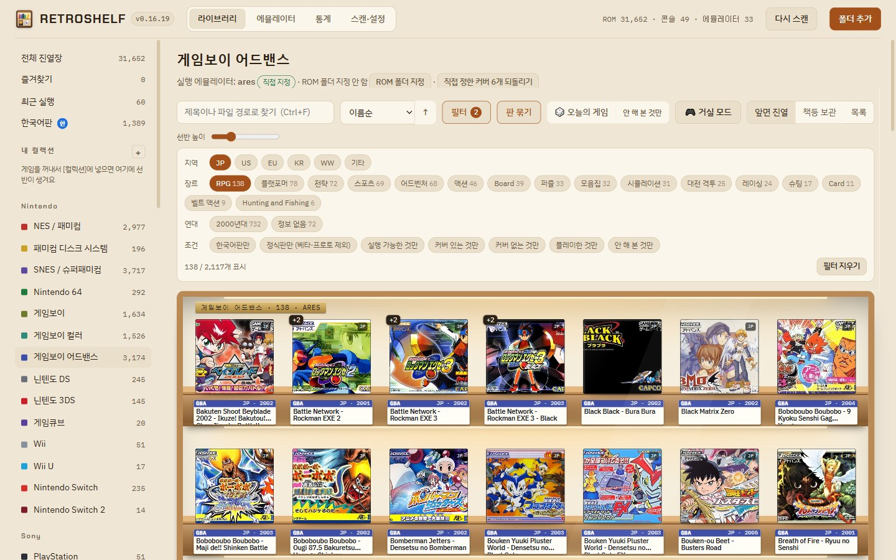

| 줄 | 고를 수 있는 것 |
|---|---|
| 지역 | JP · US · EU · KR · WW · 기타. 여러 개를 고르면 그중 하나라도 맞는 게임 |
| 장르 | 게임 정보에서 받은 장르. 옆 숫자는 그 장르의 게임 수 |
| 연대 | 70년대, 80년대 … 2020년대, 정보 없음 |
| 조건 | 한국어판만 · 정식판만(베타·프로토 제외) · 실행 가능한 것만 · 커버 있는 것만 · 커버 없는 것만 · 플레이한 것만 · 안 해 본 것만 |

**커버 있는 것만 / 커버 없는 것만**은 케이스에 그림이 들어가는지로 나눕니다. 직접 넣은 커버, 게임 옆 그림, 받은 박스아트뿐 아니라 롬에서 꺼낸 아이콘(Switch·3DS·NDS 등)으로 그려지는 게임도 **커버 있는** 쪽입니다. 기기 색과 기기 모양 아이콘만 나오는 게임이 **커버 없는** 쪽입니다.

막대 아래에 "138 / 2,117개 표시"처럼 몇 개가 남았는지 나옵니다. **필터 지우기**로 모두 끕니다. 필터는 진열장·검색 모두에 적용되고, 다음에 켤 때도 유지됩니다.

### 3.6 지역판 묶기

**판 묶기**를 켜면 같은 콘솔에서 제목이 같은 지역판·리비전·베타를 케이스 하나로 묶습니다.

- 선반에는 대표 판 하나만 나오고, 케이스 왼쪽 위에 다른 판 개수(`+2` 등)가 붙습니다.
- 대표 판은 **정식판 → 지역 우선순위 → 실행 가능 → 최근에 한 판** 순으로 고릅니다. 한국어판이 있으면 한국어판이 대표가 됩니다.
- 지역 우선순위는 [스캔·설정 탭](#104-설정)에서 바꿉니다(기본 KR › JP › US › EU › WW).
- 필터는 묶기 **전에** 적용됩니다. 예를 들어 지역 필터를 JP로 두면 일본판이 대표로 나옵니다.
- 즐겨찾기·플레이 기록은 판마다 따로 남습니다.

다른 판으로 바꾸는 방법은 [4.3 다른 판 고르기](#43-다른-판-고르기)를 보세요.

### 3.7 오늘의 게임

**🎲 오늘의 게임**을 누르면 지금 보고 있는 선반(필터·검색 포함)에서 실행할 수 있는 게임 하나를 무작위로 골라, 그 자리까지 스크롤한 뒤 꺼내 줍니다. 옆의 **안 해 본 것만**을 켜면 한 번도 실행하지 않은 게임 중에서만 고릅니다.

---

## 4. 게임 꺼내기와 실행

### 4.1 케이스 열기

선반의 케이스를 누르면 케이스가 선반에서 빠져나와 열립니다. 왼쪽에는 **취급설명서**, 가운데에는 **매체**(카트리지·디스크·플로피), 오른쪽에는 **정보 창**이 나옵니다.

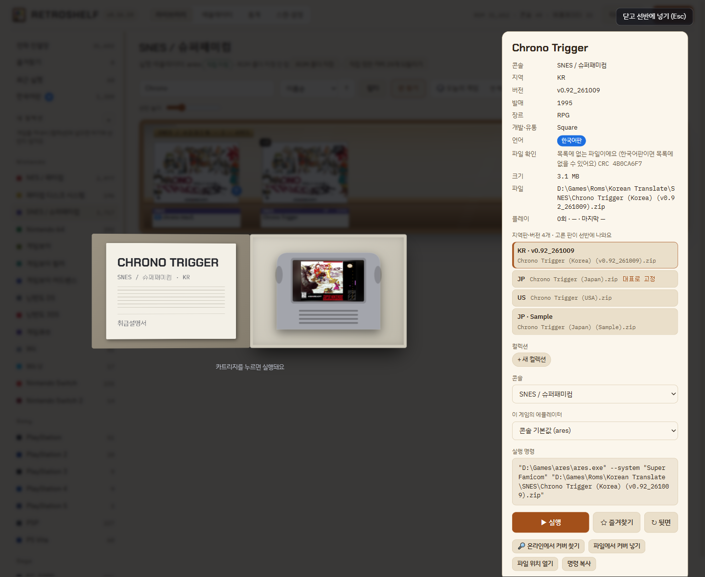

정보 창에 나오는 항목은 다음과 같습니다.

| 항목 | 내용 |
|---|---|
| 콘솔 · 지역 · 버전 | 파일 이름에서 읽은 지역·리비전·패치 버전 |
| 발매 · 장르 · 개발·유통 | libretro-database에서 받은 게임 정보 (게임 확인을 켰을 때) |
| 언어 | 한국어판이면 **한국어판** 배지 |
| 파일 확인 | CRC로 No-Intro 목록과 맞춘 결과. 목록에 없으면 "목록에 없는 파일"(해킹·번역·배드 덤프일 수 있음) |
| 크기 · 파일 | 파일 크기와 전체 경로 |
| 플레이 | 실행 횟수 · 총 시간 · 마지막 실행 |
| 지역판·버전 | 같은 게임의 다른 판 목록 ([4.3](#43-다른-판-고르기)) |
| 컬렉션 | 넣을 컬렉션 고르기 |
| 콘솔 | 콘솔을 잘못 알아봤으면 여기서 바꿉니다 |
| 이 게임의 에뮬레이터 | 이 게임만 다른 에뮬레이터로 실행 ([4.4](#44-게임별-에뮬레이터)) |
| 실행 명령 | 실제로 실행할 명령줄 |

정보 창 아래의 버튼:

| 버튼 | 하는 일 |
|---|---|
| ▶ 실행 | 게임을 실행합니다. 실행 중에는 **■ 게임 종료**로 바뀌어 에뮬레이터를 끌 수 있습니다. |
| ☆ 즐겨찾기 | 즐겨찾기 선반에 넣거나 뺍니다. |
| ↻ 뒷면 | 케이스를 뒤집어 뒷면을 봅니다 ([4.6](#46-케이스-뒷면)). |
| 🔎 온라인에서 커버 찾기 | 커버 그림을 직접 고릅니다 ([5.3](#53-온라인에서-커버-찾기)). |
| 파일에서 커버 넣기 | 가지고 있는 그림 파일을 커버로 씁니다. |
| 기본 커버로 | 직접 정한 커버를 지우고 자동 커버로 돌아갑니다 (직접 정했을 때만 보임). |
| 파일 위치 열기 | 탐색기에서 게임 파일을 보여 줍니다. |
| 명령 복사 | 실행 명령을 클립보드에 복사합니다. |

케이스를 닫으려면 **닫고 선반에 넣기 (Esc)** 를 누르거나, 케이스·정보 창 바깥의 빈 곳을 누릅니다.

### 4.2 실행하기

게임을 실행하는 방법은 세 가지입니다.

- 열린 케이스의 **매체**(카트리지·디스크·플로피)를 누릅니다.
- 정보 창의 **▶ 실행**을 누릅니다.
- 선반의 케이스를 **더블클릭**합니다 (꺼내지 않고 바로 실행).

실행하면 이렇게 동작합니다.

1. 필요한 경우 에뮬레이터 설정 파일을 실행 직전에 고칩니다 (PC엔진 CD System Card, PC-98 하드디스크·폰트 등 [11장](#11-기종별-기능)).
2. 에뮬레이터를 **에뮬레이터 폴더에서** 실행합니다. 전체 화면·해상도 같은 설정을 덮어쓰는 인수는 넣지 않으므로, 에뮬레이터를 직접 켰을 때의 설정이 그대로 쓰입니다.
3. 설정에 따라 RetroShelf 창은 최소화됩니다.
4. 에뮬레이터를 끄면 RetroShelf가 다시 앞으로 나오고, 플레이 시간이 기록됩니다.

> 플레이 시간은 에뮬레이터 프로세스가 끝날 때 기록됩니다. DuckStation·PCSX2의 `-batch`, Dolphin의 `-b`, RPCS3의 `--no-gui`처럼 기본 실행 인수에 들어 있는 옵션은 "게임을 끄면 에뮬레이터도 닫히게" 해서 시간을 정확히 재기 위한 것입니다.

### 4.3 다른 판 고르기

판 묶기가 켜져 있으면 정보 창에 **지역판·버전** 목록이 나옵니다. 선반에 나오는 판은 강조되어 있습니다.

- 다른 판을 누르면 그 판으로 바뀌고, 앞으로 그 판이 선반에 대표로 나옵니다.
- **대표로 고정**이 붙은 판은 자동으로 고르지 않고 사용자가 정한 판입니다.

### 4.4 게임별 에뮬레이터

**이 게임의 에뮬레이터**에서 그 게임만 다른 에뮬레이터로 실행하도록 고를 수 있습니다.

- **콘솔 기본값**: 에뮬레이터 탭에서 그 콘솔에 정한 에뮬레이터
- **ROM 폴더 지정**: 에뮬레이터 카드의 ROM 폴더에 들어 있어서 정해진 에뮬레이터
- 목록의 다른 에뮬레이터, 또는 **다른 실행 파일 직접 고르기…** 로 아무 exe나

우선순위는 **게임별 지정 → ROM 폴더 지정 → 콘솔 기본값**입니다. 다시 스캔해도 유지됩니다.

### 4.5 디스크 게임

CD·DVD 게임은 케이스 안에 디스크가 들어 있고, 디스크 라벨에 커버 그림이 인쇄된 것처럼 보입니다.

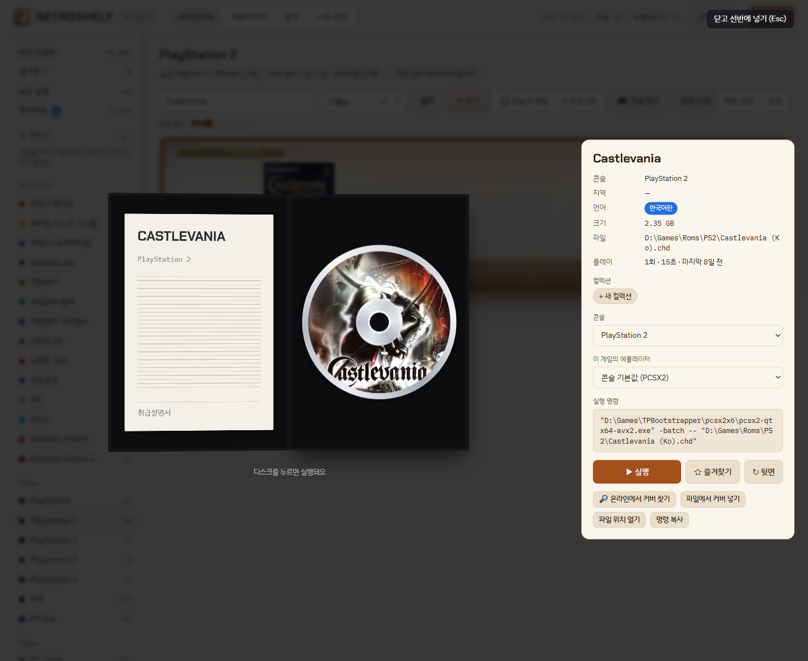

- `(Disc 1)`, `(Disc 2)`처럼 디스크 표기만 다른 파일은 한 게임으로 묶습니다. `.m3u`가 있으면 그것으로 실행합니다.
- `.cue`가 있는 폴더의 `.bin`은 따로 진열하지 않습니다.

### 4.6 케이스 뒷면

**↻ 뒷면**을 누르면 케이스를 뒤집어 뒷면을 보여 줍니다.

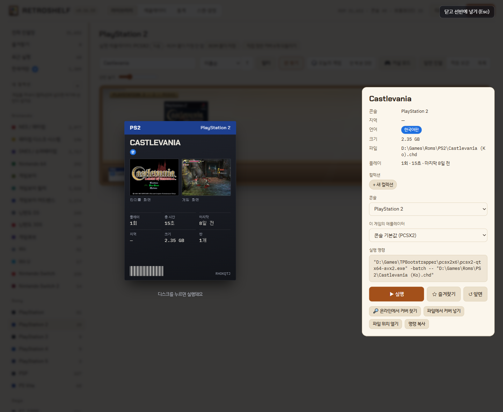

- 큰 케이스(DVD 케이스 등)는 **타이틀 화면**·**게임 화면** 스크린샷과 플레이 횟수·총 시간·마지막 실행, 지역·크기·판 수를 보여 줍니다. 스크린샷은 처음 뒤집을 때 libretro-thumbnails에서 받아 저장합니다.
- GBA·GB·DS·SNES처럼 작은 케이스는 스크린샷 대신 플레이 기록(횟수, 총 시간, 마지막·처음 플레이, 가장 길게 한 시간, 평균, 최근 플레이 날짜)을 보여 줍니다.
- 앞면으로 돌아가려면 **↺ 앞면** 또는 Esc.

### 4.7 실행에 실패했을 때

에뮬레이터가 **3초 안에** 꺼지거나, **20초 안에 오류 코드로** 꺼지면 알림 창이 뜹니다.

- 에뮬레이터가 남긴 출력에서 오류로 보이는 줄(빨간색)과 마지막 몇 줄을 보여 줍니다.
- 원인으로 보이는 것에 맞춰 안내를 덧붙입니다: 실행 인수를 알아듣지 못함, BIOS·펌웨어·키 파일 없음, 그래픽 드라이버·Vulkan 문제, 파일을 찾지 못함, 아케이드 롬셋 버전 불일치.
- **로그 파일 열기**, **명령 복사**, **실행 인수 고치기**(에뮬레이터 탭으로 이동) 버튼이 있습니다.
- 출력은 `RetroShelfData\logs`에 저장됩니다.

---

## 5. 커버 그림

### 5.1 커버를 고르는 순서

RetroShelf는 아래 순서로 커버를 찾고, 먼저 찾은 것을 씁니다.

1. **직접 넣은 커버** (파일에서 넣기, 온라인에서 고르기)
2. **게임 옆의 그림**: 게임과 같은 이름의 `png`·`jpg`·`webp`가 게임 폴더나 그 안의 `covers`, `boxart`, `media\covers`, `media\box2dfront` 폴더에 있으면 씁니다. DuckStation·PCSX2의 `covers` 폴더에서 파일 이름·제목·시리얼(예: `SLUS-00594.jpg`)로 찾은 그림도 여기에 해당합니다.
3. **인터넷에서 받은 박스아트** ([5.2](#52-박스아트-자동-받기))
4. **롬 속 아이콘**: NDS 아이콘, PSP의 `ICON0.PNG`, Wii U `iconTex.tga`, 3DS·Switch 아이콘 ([5.5](#55-롬-속-아이콘))
5. 아무것도 없으면 **기기 색과 기기 모양 아이콘**

### 5.2 박스아트 자동 받기

[설정](#104-설정)의 **커버가 없는 게임은 박스아트를 인터넷에서 받기**가 켜져 있으면, 스캔이 끝난 뒤 [libretro-thumbnails](https://github.com/libretro-thumbnails/libretro-thumbnails)에서 박스아트를 받습니다.

- 찾는 순서: 롬 파일 이름 그대로 → 디스크 표기를 뺀 이름 → 파일 내용(CRC)으로 찾은 정식 이름 → 제목이 같은 이름 → 제목 낱말이 많이 겹치는 이름.
- 제목을 비교할 때는 괄호 표기·관사·기호를 빼고, 로마 숫자와 아라비아 숫자를 같게 봅니다(`Zelda 2` ↔ `Zelda II - The Adventure of Link`). 속편 번호가 다르면 다른 게임으로 봅니다.
- 낱말 비교로 찾은 박스아트는 정보 창에 "비슷한 제목으로 찾은 박스아트"라고 표시됩니다. 틀렸으면 [온라인에서 커버 찾기](#53-온라인에서-커버-찾기)로 바꾸세요.
- 받은 그림은 `RetroShelfData\boxart`에 저장되어 인터넷 없이도 계속 보입니다.
- 한 번 못 찾은 게임은 다시 찾지 않습니다. 파일 이름을 고친 뒤 설정의 **못 찾은 게임 다시 찾기**를 누르세요.
- PS5·Switch는 libretro에 목록이 없어 받지 않습니다.

### 5.3 온라인에서 커버 찾기

케이스를 연 뒤 **🔎 온라인에서 커버 찾기**를 누르면 커버를 직접 고르는 창이 뜹니다.

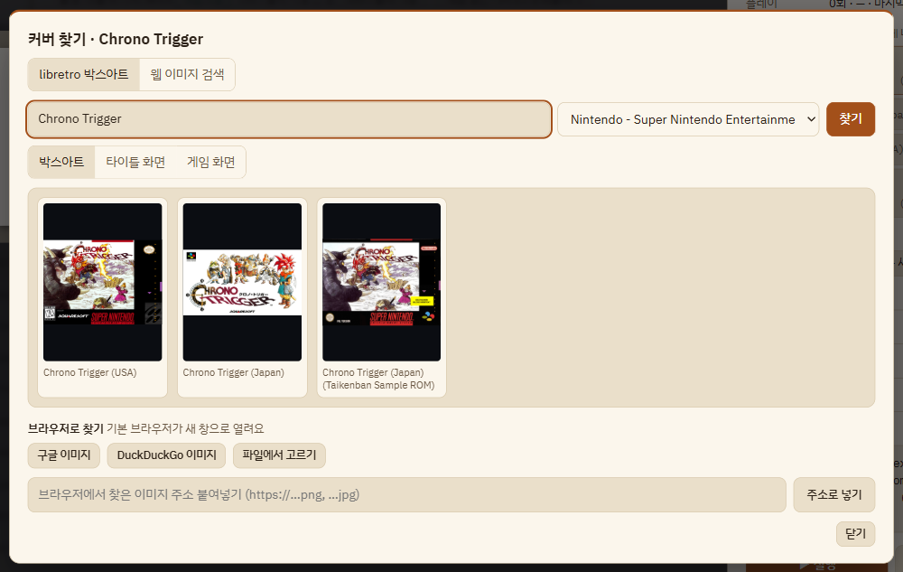

- **libretro 박스아트** 탭: 제목으로 libretro-thumbnails 목록을 검색해 그림을 늘어놓습니다. **박스아트 · 타이틀 화면 · 게임 화면** 중에서 고를 수 있고, 오른쪽 상자에서 다른 콘솔 목록으로 바꿔 찾을 수도 있습니다.
- **웹 이미지 검색** 탭: 앱 안에서 웹 이미지를 검색합니다(DuckDuckGo, 실패하면 Bing). Bing으로 넘어가면 DuckDuckGo가 실패한 이유를 보여 주고, **DuckDuckGo로 다시 시도** 버튼이 나옵니다. libretro 목록에 맞는 그림이 없으면 자동으로 이 탭으로 넘어갑니다.
- 그림을 누르면 그 게임의 커버가 됩니다.
- **브라우저로 찾기**: **구글 이미지**·**DuckDuckGo 이미지**를 기본 브라우저로 엽니다. 찾은 이미지 주소를 아래 칸에 붙여 넣고 **주소로 넣기**를 누르세요.
- **파일에서 고르기**: 가지고 있는 그림 파일을 고릅니다.

> 웹 이미지 검색은 공식 API가 아니어서, 검색 사이트가 바뀌면 동작하지 않을 수 있습니다.

### 5.4 직접 정한 커버 되돌리기

- 게임 하나: 정보 창의 **기본 커버로**.
- 콘솔 전체: 콘솔 선반 머리말의 **직접 정한 커버 N개 되돌리기**를 두 번 누릅니다.

### 5.5 롬 속 아이콘

커버가 없을 때는 롬 파일 안의 아이콘을 꺼내 케이스·설명서·카트리지 라벨에 씁니다.

- **3DS**: CIA, 복호화된 `.3ds`·`.cci`·`.cxi`, `.3dsx`에서 48×48 아이콘을 꺼냅니다. 암호화된 `.3ds`는 건너뜁니다.
- **Switch**(`.nsp`·`.xci`·`.nsz`·`.xcz`): 256×256 아이콘을 꺼냅니다. 파일이 암호화되어 있어 에뮬레이터가 쓰는 **`prod.keys`** 가 필요합니다. Eden·yuzu·Ryujinx 등 등록된 에뮬레이터 폴더와 AppData에서 자동으로 찾고, 없으면 [설정](#104-설정)의 **prod.keys 지정**으로 고릅니다. 키는 복호화에만 쓰고 어디로도 보내지 않습니다. 한국어 아이콘이 있으면 먼저 씁니다.
- Switch는 커버가 없으면 패키지 앞면처럼 보여 줍니다(흰 NINTENDO SWITCH 라벨 + 큰 아이콘 + 흐린 배경과 제목).

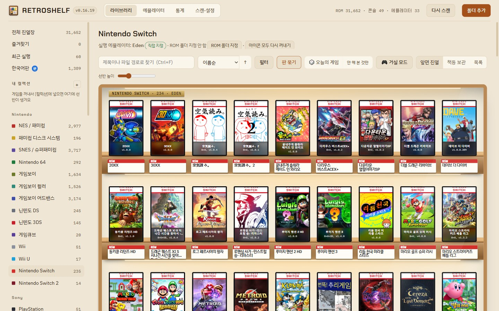

Switch 게임 정보 창의 **타이틀 아이콘** 줄에는 아이콘을 못 꺼낸 이유, 쓰고 있는 prod.keys 위치, **다시 꺼내기** 버튼이 나옵니다. Switch 선반 머리말의 **아이콘 꺼내기**로 아이콘이 없는 게임을 한 번에 꺼낼 수도 있습니다.

### 5.6 안 쓰는 그림 정리

게임이 목록에서 빠지거나 커버를 기본으로 되돌리면, 어떤 게임도 쓰지 않는 그림(`RetroShelfData`의 `boxart`·`covers`·`icons`)을 자동으로 지웁니다. 연결이 끊긴 드라이브의 게임은 목록에 남아 있으므로 그림도 남습니다. 그림 파일을 손으로 지웠으면 다음 실행 때 다시 받거나 다시 꺼냅니다.

---

## 6. 내 컬렉션

콘솔과 상관없이 직접 이름을 붙인 선반을 만들 수 있습니다.

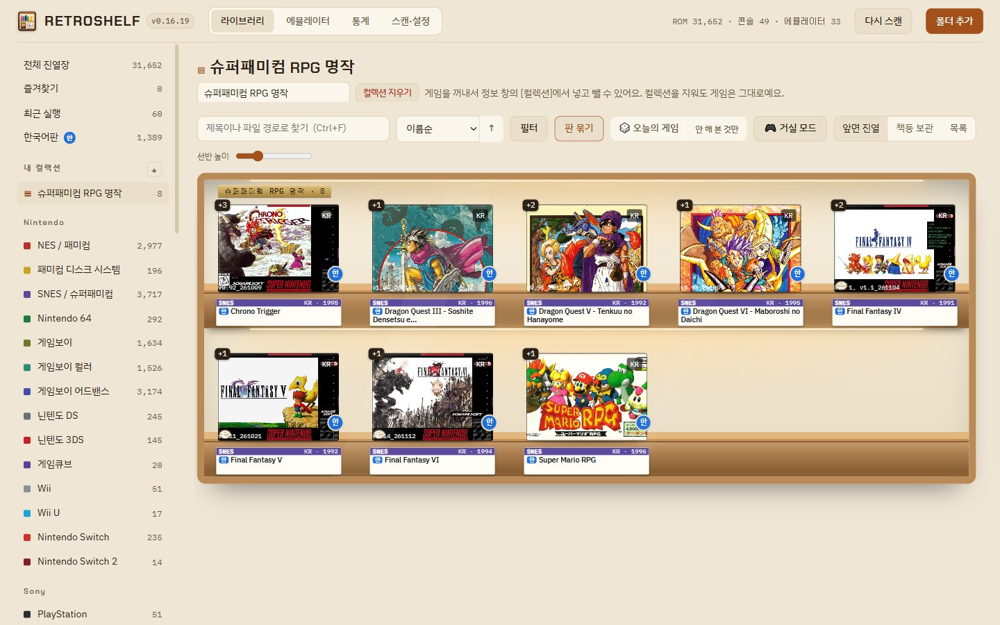

- **만들기**: 왼쪽 목록 **내 컬렉션** 옆의 **+**, 또는 게임 정보 창의 **+ 새 컬렉션**.
- **넣고 빼기**: 게임 정보 창의 **컬렉션** 줄에서 컬렉션 이름 버튼을 누릅니다(누를 때마다 넣고 뺌).
- **이름 바꾸기**: 컬렉션 화면 위쪽의 이름 칸을 고칩니다.
- **지우기**: 컬렉션 화면 위쪽의 **컬렉션 지우기**. 컬렉션을 지워도 게임은 그대로입니다.

---

## 7. 거실 모드 (패드)

**🎮 거실 모드**(F11, 또는 패드의 Start)는 전체 화면에서 선반만 크게 보여 주고, 아래에 버튼 안내가 나옵니다. TV에 연결해 소파에서 패드로 고를 때 쓰세요. Xbox·DualSense 등 XInput/표준 패드를 쓸 수 있습니다.

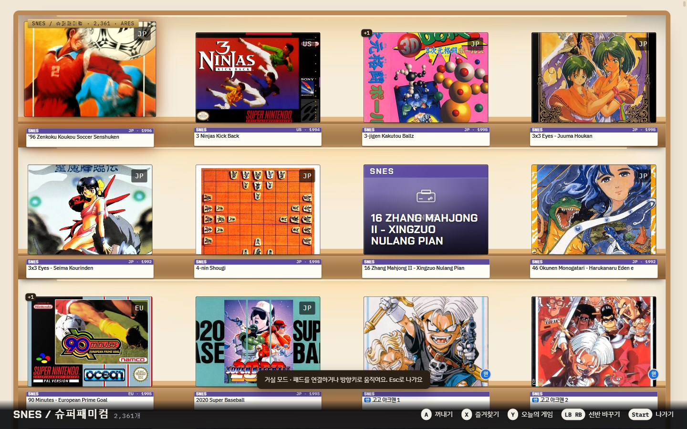

| 패드 | 선반에서 | 케이스를 꺼냈을 때 |
|---|---|---|
| 방향키 · 왼쪽 스틱 | 케이스 이동 | ◀ ▶ 다른 판, ▲ ▼ 정보 창 스크롤 |
| A | 꺼내기 | 실행 |
| B | 거실 모드 나가기 | 닫기 (뒷면이면 앞면으로) |
| X | 즐겨찾기 | 즐겨찾기 |
| Y / Back | 오늘의 게임 | 뒷면 보기 |
| LB / RB | 이전·다음 선반 (전체, 즐겨찾기, 컬렉션, 콘솔) | — |
| Start | 거실 모드 켜기·끄기 | — |

- 게임이 실행 중일 때는 패드 입력이 에뮬레이터로만 가도록 RetroShelf가 패드를 무시합니다.
- 키보드로도 방향키 · Enter · Esc로 똑같이 움직일 수 있습니다.

---

## 8. 플레이 통계

**통계** 탭에서 RetroShelf로 실행한 기록을 봅니다.

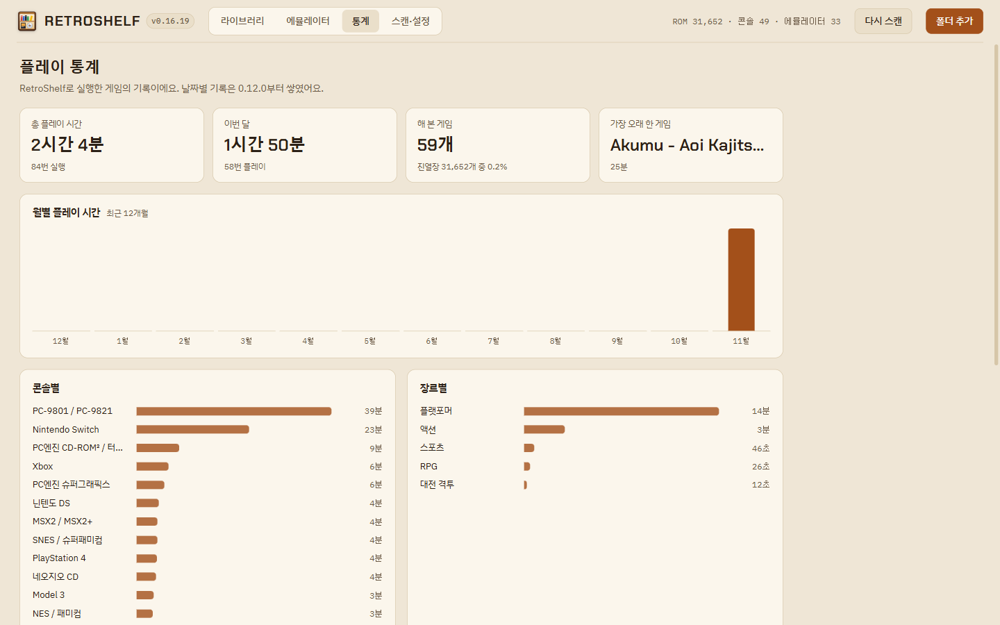

- 위쪽 카드: **총 플레이 시간**, **이번 달**, **해 본 게임**(진열장 전체 중 비율), **가장 오래 한 게임**
- **월별 플레이 시간** (최근 12개월)
- **콘솔별**, **장르별** 플레이 시간
- **많이 한 게임** 10개, **최근 플레이** 기록

게임 이름을 누르면 진열장에서 그 게임을 꺼내 줍니다. 플레이 날짜별 기록은 0.12.0부터 쌓이며, 게임마다 최근 30번까지 남습니다.

---

## 9. 에뮬레이터 탭

### 9.1 콘솔별 실행 에뮬레이터

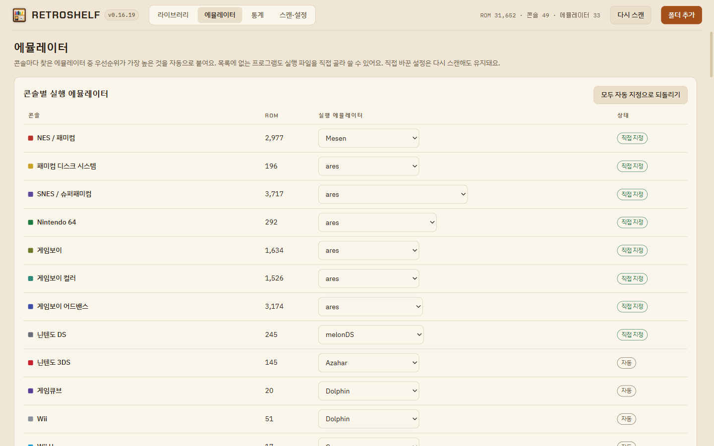

콘솔마다 쓸 에뮬레이터를 고릅니다.

- **자동**: 찾은 에뮬레이터 중 우선순위가 가장 높은 것을 RetroShelf가 붙인 상태. 새 에뮬레이터를 찾으면 다시 정해집니다.
- **직접 지정**: 사용자가 고른 상태. 다시 스캔해도 바뀌지 않습니다.
- 선택 상자의 **다른 실행 파일 직접 고르기…** 로 목록에 없는 exe를 그 콘솔의 에뮬레이터로 쓸 수 있습니다.
- **모두 자동 지정으로 되돌리기**: 모든 콘솔을 자동 상태로 돌립니다.

RetroArch는 `cores` 폴더의 `*_libretro.dll`을 보고 돌릴 수 있는 콘솔을 판단합니다. 같은 콘솔을 돌리는 코어가 여럿이면 선택 상자에 코어별로 나옵니다.

### 9.2 에뮬레이터 카드

탭 아래쪽에는 찾은 에뮬레이터마다 카드가 있습니다.

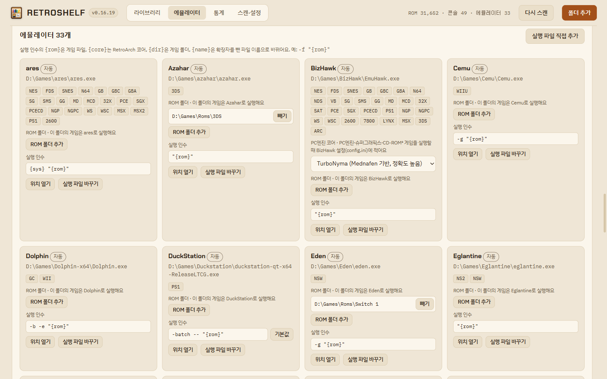

| 부분 | 설명 |
|---|---|
| 이름 · 자동/직접 | 에뮬레이터 이름과 찾은 방식 |
| 경로 | 실행 파일 위치 |
| 기종 칩 | 이 에뮬레이터로 돌릴 수 있는 콘솔 |
| ROM 폴더 | 이 폴더의 게임은 폴더 이름과 상관없이 이 에뮬레이터가 돌리는 기기로 분류되고, 이 에뮬레이터로 실행됩니다. **ROM 폴더 추가**로 지정하고 **빼기**로 뺍니다. 에뮬레이터 폴더 안의 폴더(예: RetroArch의 `roms`)도 됩니다. |
| 실행 인수 | 명령줄 템플릿. 고치면 바로 적용되고, **기본값**으로 되돌릴 수 있습니다. |
| 위치 열기 | 탐색기에서 에뮬레이터 폴더를 엽니다. |
| 실행 파일 바꾸기 | 자동으로 찾은 exe 대신 다른 exe(예: 런처 대신 본체, 다른 버전)를 씁니다. 다시 스캔해도 유지되고, **자동으로 되돌리기**로 원래대로 돌립니다. |

일부 에뮬레이터 카드에는 추가 설정이 있습니다.

- **BizHawk**: PC엔진 코어 고르기 ([11.2](#112-bizhawk-pc엔진-코어))
- **Neko Project**: PC-98 기본 폰트 ([11.3](#113-pc-98-neko-project))

### 9.3 실행 인수 자리표시자

실행 인수에는 아래 자리표시자를 씁니다. 실행할 때 실제 값으로 바뀝니다.

| 자리표시자 | 바뀌는 값 |
|---|---|
| `{rom}` | 게임 파일 전체 경로 |
| `{rom2}` | 두 번째 디스크 (없으면 이 토큰이 빠짐) |
| `{core}` | RetroArch 코어 경로 |
| `{dir}` | 게임 폴더 |
| `{name}` | 확장자를 뺀 파일 이름 |
| `{lname}` | 확장자를 뺀 롬 이름 (MAME·FBNeo·Model 2) |
| `{sys}` | 기종 지정 인수 (ares의 `--system "Mega CD"`, Kega Fusion의 `-scd` 등) |

예: `-f "{rom}"` → `-f "D:\Games\Roms\SNES\Chrono Trigger (Japan).zip"`

경로에 빈칸이 있을 수 있으니 `{rom}`은 따옴표로 감싸 두세요.

### 9.4 목록에 없는 에뮬레이터 쓰기

탭 아래쪽의 **실행 파일 직접 추가**로 exe를 고릅니다.

- RetroShelf가 아는 에뮬레이터면 그 실행 방식을 그대로 씁니다.
- 모르는 프로그램이면 카드가 새로 생기고, 카드에서 **실행할 콘솔**을 눌러 켜고 이름·실행 인수를 정합니다.

---

## 10. 스캔·설정 탭

### 10.1 스캔할 폴더

등록한 폴더 목록입니다. 폴더마다 **열기**(탐색기)와 **빼기**가 있습니다. **전체 다시 스캔**(F5)은 모든 폴더를 다시 살펴봅니다.

- 폴더를 빼도 바로 진열장에서 사라지지는 않습니다. 다시 스캔하면 정리됩니다.
- 연결이 끊긴 드라이브(USB 등)의 게임은 진열장에 남아 있다가, 다시 연결하면 그대로 씁니다.

### 10.2 스캔에서 뺄 폴더

상위 폴더 하나를 통째로 등록했을 때 원하지 않는 파일이 섞이는 것을 막습니다.

- **폴더 트리에서 여러 개 고르기**: 등록한 스캔 폴더 아래 하위 폴더가 트리로 펼쳐지고, 체크박스로 여러 폴더를 한 번에 고릅니다.
- **폴더 하나 직접 추가**: 폴더 하나만 고릅니다.

뺀 폴더와 그 아래 파일은 스캔하지 않습니다.

### 10.3 콘솔별 ROM 폴더

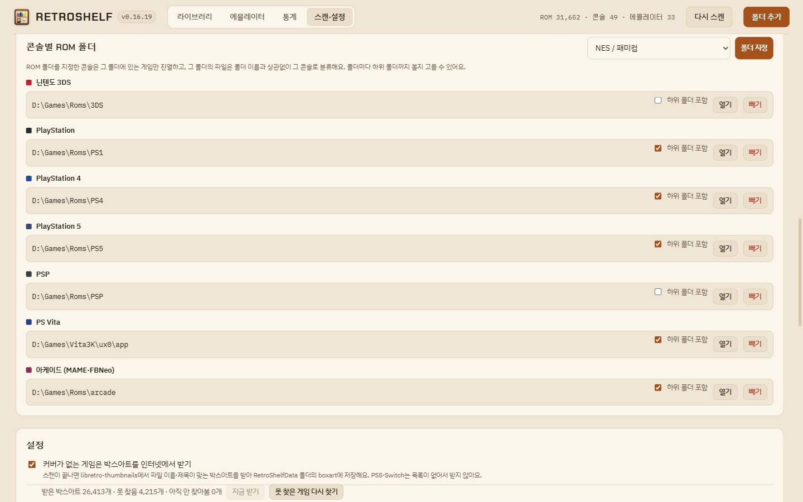

오른쪽 위 상자에서 콘솔을 고르고 **폴더 지정**을 누릅니다. 라이브러리에서 콘솔 선반을 골랐을 때 머리말의 **ROM 폴더 지정**으로도 추가할 수 있습니다.

- 폴더를 지정한 콘솔은 **그 폴더 안의 게임만** 진열합니다. 다른 곳에서 찾은 같은 콘솔 게임은 숨기고, 숨긴 개수를 스캔 기록에 적습니다.
- 지정한 폴더 안의 게임은 폴더 이름과 상관없이 그 콘솔로 분류합니다.
- 폴더마다 **하위 폴더 포함** 체크 상자가 있습니다. 끄면 그 폴더 바로 아래 파일만 봅니다.
- 폴더를 지정하지 않은 콘솔은 등록한 스캔 폴더 전체에서 찾습니다.

### 10.4 설정

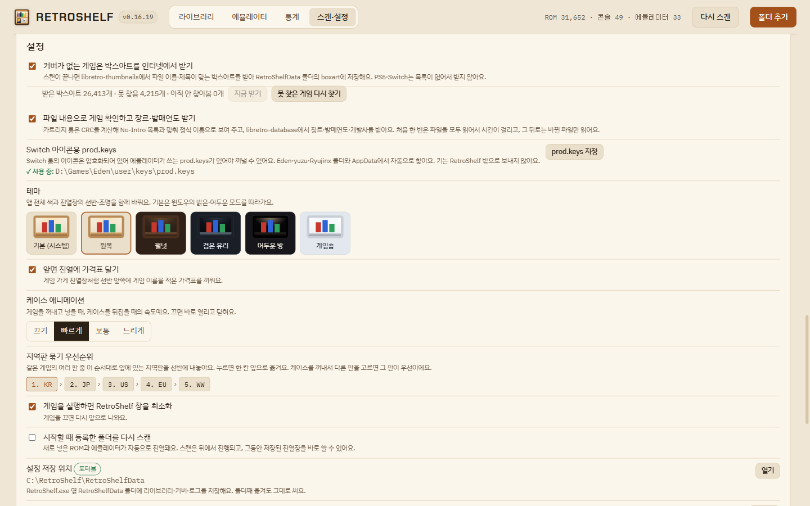

| 설정 | 설명 |
|---|---|
| 커버가 없는 게임은 박스아트를 인터넷에서 받기 | [5.2](#52-박스아트-자동-받기). 아래 줄에 받은 수·못 찾은 수와 **지금 받기**, **못 찾은 게임 다시 찾기** 버튼 |
| 파일 내용으로 게임 확인하고 장르·발매연도 받기 | 카트리지 롬(128MB 이하)의 CRC를 계산해 No-Intro 목록과 맞추고, 장르·발매연도·개발사를 받습니다. 처음 한 번은 시간이 걸리고, 그 뒤로는 바뀐 파일만 읽습니다. 디스크 게임은 파일 이름 속 시리얼(예: `SCUS-94228`)이나 이름으로 Redump 목록과 맞춥니다. |
| Switch 아이콘용 prod.keys | 자동으로 찾은 위치가 "사용 중"에 나옵니다. **prod.keys 지정**으로 직접 고릅니다. |
| 테마 | [13장](#13-테마와-애니메이션) |
| 앞면 진열에 가격표 달기 | 선반 앞쪽 레일의 가격표를 켜고 끕니다. |
| 케이스 애니메이션 | 끄기 · 빠르게(기본) · 보통 · 느리게 |
| 지역판 묶기 우선순위 | 누르면 한 칸 앞으로 옮깁니다. 기본 KR › JP › US › EU › WW |
| 게임을 실행하면 RetroShelf 창을 최소화 | 게임을 끄면 다시 앞으로 나옵니다. |
| 시작할 때 등록한 폴더를 다시 스캔 | 새로 넣은 롬·에뮬레이터가 자동으로 진열됩니다. 스캔은 뒤에서 진행되고, 그동안 저장된 진열장을 바로 쓸 수 있습니다. |
| 설정 저장 위치 | 데이터 폴더 경로. "포터블"이면 exe 옆에 저장 중입니다. **열기**로 탐색기에서 엽니다. |
| 진열장 비우기 | 즐겨찾기, 플레이 기록, 직접 지정한 설정까지 모두 지웁니다. 두 번 눌러야 실행됩니다. 되돌릴 수 없으니 먼저 [백업](#14-데이터-폴더와-백업)하세요. |

### 10.5 분류 규칙

설정 아래에는 확장자별로 어떤 콘솔로 분류하는지 표가 있습니다.

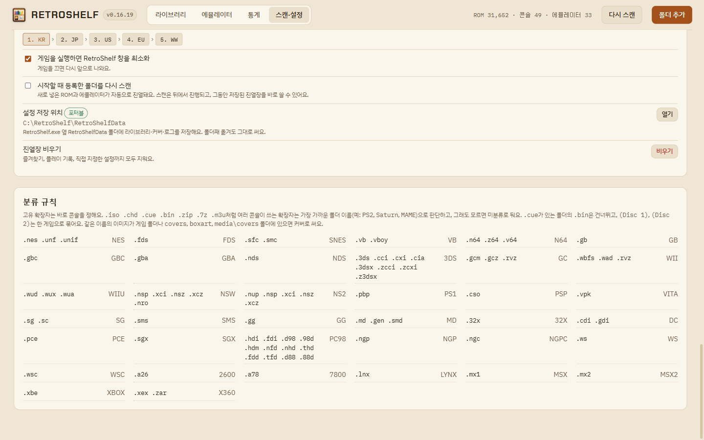

- 한 콘솔만 쓰는 확장자는 바로 그 콘솔로 정합니다.
- `.iso .chd .cue .bin .zip .7z .m3u`처럼 여러 콘솔이 쓰는 확장자는 가장 가까운 폴더 이름(예: `PS2`, `Saturn`, `MAME`)으로 판단하고, 그래도 모르면 **미분류**로 둡니다.
- BIOS·펌웨어 파일은 게임이 아니므로 뺍니다: `bios`·`firmware` 폴더 안의 파일, 이름에 `[BIOS]`·`BIOS`가 들어간 파일, 잘 알려진 BIOS 파일 이름(`SCPH1001`, `gba_bios`, `neogeo`, `syscard3`, `disksys` 등). 뺀 개수는 스캔 기록에 나옵니다.
- 업데이트·DLC는 게임이 아니므로 뺍니다: Switch(타이틀 ID 끝이 `800`이거나 `[UPD]`·`[DLC]` 표기), Wii U(`0005000e`·`0005000c` 폴더), PS4 패치·추가 콘텐츠, PS5의 `-patch0`·`-ac` 폴더.

---

## 11. 기종별 기능

### 11.1 PC엔진 CD System Card

PC엔진 CD 게임은 게임마다 어떤 System Card로 실행할지 고를 수 있습니다(예: 한글 패치 전용 System Card).

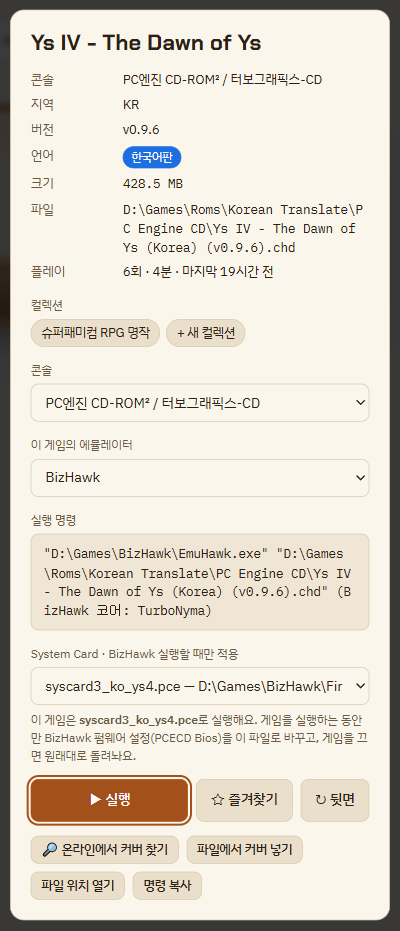

- 정보 창의 **System Card** 상자에서 고릅니다. **System Card 파일 추가…** 로 고른 파일은 다른 게임에서도 목록에 나옵니다.
- **Mednafen**: Mednafen의 게임별 설정 파일(`pgconfig\게임이름.pce.cfg`)에 적습니다. Mednafen 전체 설정은 바뀌지 않습니다.
- **BizHawk**: 게임을 실행하는 동안만 `config.ini`의 PCE CD BIOS를 고른 파일로 바꾸고, 게임을 끄면 원래 값으로 되돌립니다.
- 다른 에뮬레이터는 실행할 때 System Card를 바꿀 방법이 없어 이 기능이 꺼집니다.

### 11.2 BizHawk PC엔진 코어

에뮬레이터 탭의 BizHawk 카드에서 **PC엔진 코어**(TurboNyma · HyperNyma · PCEHawk)를 고르면, PC엔진·슈퍼그래픽스·CD-ROM² 게임을 실행할 때 `config.ini`의 `PreferredCores`에 적습니다. 처음 고칠 때 `config.ini.bak`으로 백업합니다.

### 11.3 PC-98 (Neko Project)

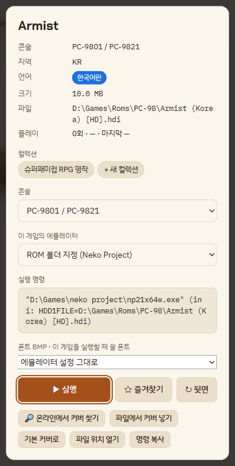

- `.hdi .fdi .d88 .hdm .nfd .nhd .thd .fdd .tfd .d98` 이미지를 PC-9801 / PC-9821로 분류합니다. `PC-98` 같은 이름의 폴더에 넣어 두면 확실합니다.
- Neko Project 계열(`np2`, `np21w`, `np21x64w`, `np2kai`, `sdlnp21kai` …)과 RetroArch `np2kai` 코어에 자동 연결합니다. 같은 폴더에 여러 판이 있으면 21/W(`np21x64w`)를, 가속판(haxm·whpx 폴더)보다 보통판을 고릅니다.
- **플로피 게임**: `np21x64w.exe "디스크1" "디스크2"`처럼 명령줄로 넘겨 FDD1·FDD2에 넣습니다. 세 장째부터는 에뮬레이터 메뉴에서 바꿔 넣으세요.
- **하드디스크 게임**(`.hdi .nhd .thd .hdd .vhd`): 실행 직전에 exe 옆 ini의 `HDD1FILE=`(둘째는 `HDD2FILE=`)에 적고, 지난번 플로피를 비워 하드디스크로 부팅하게 합니다. 바꾼 값은 그 설정이 필요 없는 게임을 실행할 때 원래대로 되돌립니다.
- **폰트 BMP (게임별)**: 정보 창의 **폰트 BMP**에서 게임마다 폰트를 고릅니다. 에뮬레이터 폴더와 그 안 `Font` 폴더의 BMP가 목록에 나옵니다. 에뮬레이터 탭에서 정한 **기본 폰트**는 게임별로 정하지 않은 게임에 씁니다.
- ini 값은 Windows 시스템 코드 페이지로 적어서 한글·일본어 경로도 그대로 씁니다.
- Neko Project는 zip을 열지 못하므로 압축을 풀어 두세요(정보 창에도 안내가 나옵니다).

### 11.4 Wii U — Cemu 그래픽 팩

Wii U 게임을 Cemu로 실행하도록 정해 두면, 정보 창에 그 게임에 맞는 **그래픽 팩** 목록이 나옵니다.

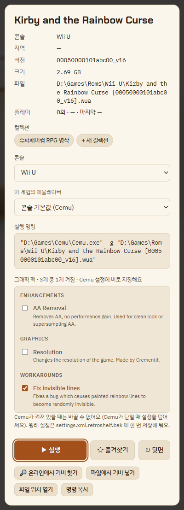

- 체크하면 켜지고, 해상도·FPS 같은 프리셋은 목록에서 고릅니다.
- 바꾸는 즉시 Cemu `settings.xml`에 저장되고, 다른 설정은 건드리지 않습니다. 처음 고칠 때 `settings.xml.retroshelf.bak`으로 백업합니다.
- Cemu가 켜져 있을 때는 바꿀 수 없습니다(Cemu가 닫힐 때 설정을 덮어씀).
- 그래픽 팩이 없으면 Cemu의 **옵션 → 그래픽 팩 → 최신 그래픽 팩 다운로드**를 먼저 해 주세요.

### 11.5 아케이드 — 원본·클론과 FBNeo IPS 패치

아케이드 롬셋(`sf2.zip`, `sf2ua.zip` 같은 짧은 이름)은 FBNeo DAT와 MAME 목록에 맞춰 실제 제목과 지역·연도·제조사를 보여 줍니다.

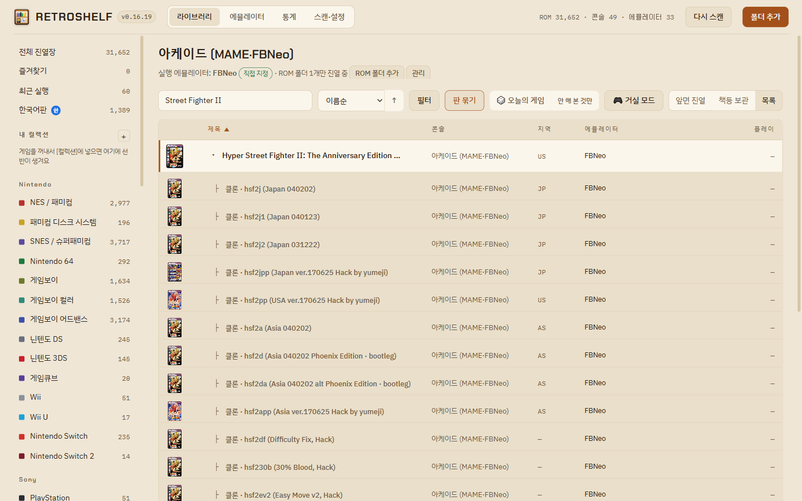

- 판 묶기가 켜져 있으면 원본(parent) 아래에 클론이 묶여 케이스 하나로 나옵니다. 목록 보기에서는 `▸`로 펼칩니다.
- 정보 창에는 원본과 클론이 계층으로 나오고, 클론을 누르면 그 판이 선반에 나옵니다.
- 클론의 박스아트가 없으면 원본 그림을 씁니다.

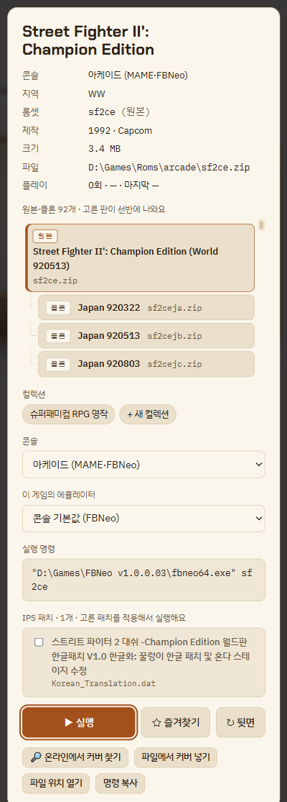

- **FBNeo IPS 패치**: FBNeo로 실행하는 게임은 정보 창에 그 게임의 IPS 패치 목록이 나옵니다(`support\ips\게임이름\*.dat`). 설명은 한국어 → 영어 → 일본어 → 중국어 순으로 보여 줍니다. 체크한 패치는 `-ips`로 넘겨 적용한 채 실행하고, 게임마다 기억합니다.
- **FBNeo ROM 경로에 추가**: FBNeo 단독판은 게임 이름(예: `sf2`)만 받고 FBNeo에 등록된 ROM 폴더에서 찾습니다. 게임 폴더가 등록돼 있지 않으면 정보 창에 이 버튼이 나옵니다. 누르면 FBNeo 설정에 폴더를 넣고 원래 파일은 `.bak`으로 남깁니다.
- **MAME**: `mame.ini`의 `rompath`를 읽어 게임 폴더 뒤에 붙이므로 BIOS 경로도 그대로 쓰입니다.
- 아케이드 롬셋은 에뮬레이터 버전과 롬셋 버전이 맞아야 실행됩니다.

### 11.6 Sega Model 1 · Model 2 · Model 3

- `Model 2`·`Sega Model 2`·`m2emulator` 폴더의 `.zip`은 Model 2, `Model 1` 폴더의 `.zip`은 Model 1 게임으로 분류하고, `vf2`·`daytona` 같은 롬셋 이름을 실제 제목으로 보여 줍니다.
- **sm2-emu**(권장): 스캔 폴더 안에 `sm2-emu.exe`가 있으면 Model 1·2에 자동 연결하고 롬 zip 경로를 넘겨 실행합니다. `games.xml`을 읽어 제목·버전·연도·제조사를 채웁니다. 클론은 부모 롬이 같은 폴더에 있어야 합니다.
- **ElSemi Model 2 Emulator**: 롬셋 이름만 받고 `EMULATOR.INI`의 `[RomDirs]`에서 찾습니다. 폴더가 없으면 정보 창의 **Model 2 Emulator ROM 폴더에 추가**를 누르세요.
- **Model 3**: Supermodel 또는 MAME로 실행합니다.

### 11.7 폴더째 들어 있는 게임

| 기종 | 알아보는 형식 |
|---|---|
| PS3 | `PS3_GAME\USRDIR\EBOOT.BIN` 폴더. `param.sfo`에서 제목을 읽습니다. |
| PS4 · PS5 | `eboot.bin` 폴더 (PS5는 폴더 이름으로 구분). `param.sfo`·`param.json`에서 제목을 읽고, 폴더 이름 끝의 `-app0`은 떼고 표시합니다. |
| PS Vita | `.vpk`, `eboot.bin` 덤프 폴더, Vita3K에 이미 설치된 게임 |
| Xbox · Xbox 360 | `default.xbe` · `default.xex` |
| Wii U | 압축 푼 폴더(`meta\meta.xml`), `.wua`, `.wud`, `.wux` |
| Switch · Switch 2 | 같은 `.nsp`·`.xci`를 쓰므로 폴더 이름(`Switch 2`, `NS2` 등)으로 구분 |
| TeknoParrot | `UserProfiles` 폴더에 설정해 둔 게임을 `--profile=이름.xml`로 실행 |

---

## 12. 한국어판 표시

파일·폴더 이름에 한국어를 뜻하는 표기가 있으면 **한국어판**으로 봅니다. 정식 한국판인지 한글패치인지는 이름만으로 가릴 수 없어서 따로 나누지 않습니다.

- 알아보는 표기: `kor`, `korea`, `korean`, `T-Kor`, `(K)`, 언어 목록의 `Ko`(예: `(En,Ja,Ko)`), `한글`, `한국어`, `한국판`, `한패`
- 케이스에 파란 **한** 배지가 붙고, 정보 창에 "한국어판"이 표시됩니다.
- 왼쪽 목록에 **한국어판** 선반이 생기고, 필터의 **한국어판만**으로도 고를 수 있습니다.
- 판 묶기에서는 한국어판이 대표로 나옵니다.
- 한국어판은 No-Intro 목록에 없는 경우가 많아서, 파일 확인에서 "목록에 없는 파일"로 나와도 정상입니다. 이때 제목은 파일 이름을 그대로 씁니다.

---

## 13. 테마와 애니메이션

[설정](#104-설정)의 **테마**에서 고릅니다. 앱 전체의 바탕·패널·글자·강조색과 진열장의 선반 판·뒷벽·조명이 함께 바뀝니다. 모든 테마는 글자와 바탕의 명도 대비를 4.5:1 이상으로 맞췄습니다.

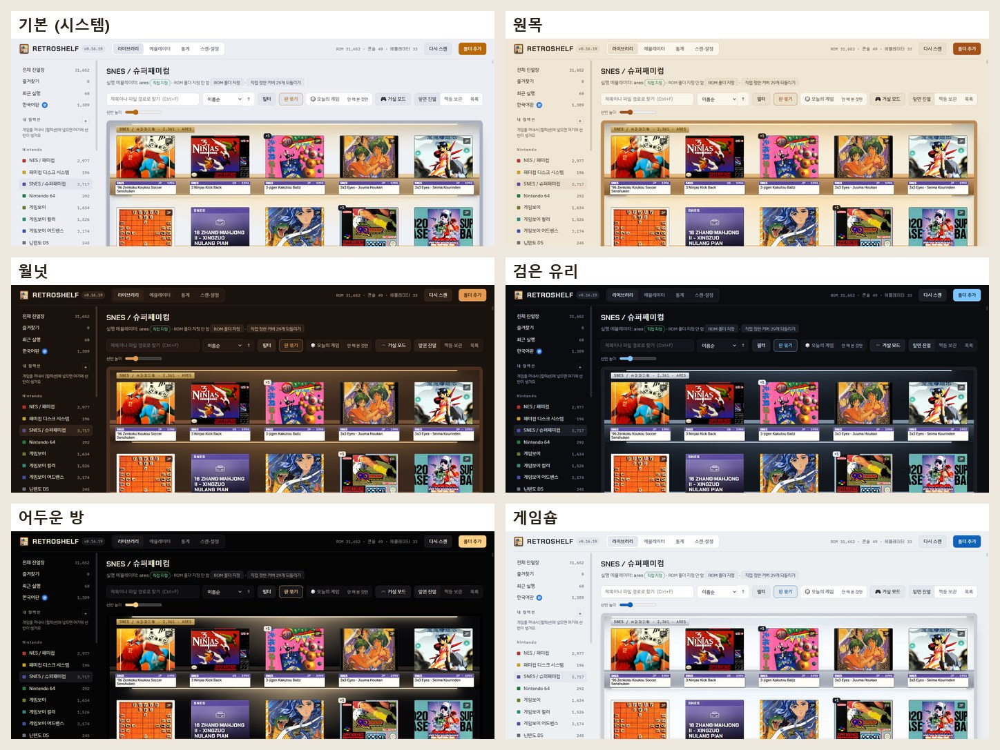

| 테마 | 느낌 |
|---|---|
| 기본 (시스템) | Windows의 밝은·어두운 모드를 따라갑니다. |
| 원목 | 밝은 나무 선반 |
| 월넛 | 짙은 호두나무 선반 |
| 검은 유리 | 어두운 유리장 |
| 어두운 방 | 불 끈 방에서 선반 조명만 켠 느낌 |
| 게임숍 | 밝은 매장 진열대 |

**케이스 애니메이션**은 케이스를 꺼내고 넣을 때, 뒤집을 때의 속도입니다. 끄면 케이스가 바로 열리고 닫힙니다.

---

## 14. 데이터 폴더와 백업

RetroShelf의 모든 데이터는 `RetroShelf.exe` 옆의 **`RetroShelfData`** 폴더에 저장됩니다(포터블). 실행 폴더에 쓸 수 없을 때(예: `C:\Program Files`)만 사용자 AppData를 씁니다. 실제 위치는 [설정](#104-설정)의 **설정 저장 위치**에서 확인합니다.

| 경로 | 내용 |
|---|---|
| `library.json` | 진열장 전체 (게임 목록, 에뮬레이터 지정, 즐겨찾기, 컬렉션, 플레이 기록, 설정) |
| `boxart\` | 인터넷에서 받은 박스아트·스크린샷, 웹에서 고른 커버 |
| `covers\` | 파일에서 직접 고른 커버 |
| `icons\` | 롬에서 꺼낸 아이콘 |
| `meta\` | 게임 정보 목록과 CRC 캐시 |
| `arcade\` | 아케이드 롬셋 목록 (30일마다 새로 받음) |
| `logs\` | 실행에 실패한 에뮬레이터의 출력 |
| `webview\` | 화면 캐시 |

- **백업**: RetroShelf를 끈 뒤 `RetroShelfData` 폴더를 통째로 복사하세요. 최소한 `library.json`만 있어도 진열장·기록·설정은 되살릴 수 있습니다(그림은 다시 받으면 됩니다).
- **다른 PC·USB로 옮기기**: `RetroShelf.exe`와 `RetroShelfData`를 같이 옮기면 그대로 씁니다.
- **드라이브 문자가 바뀌었을 때**: 예를 들어 USB가 `E:`에서 `F:`가 되면, 시작할 때 저장된 경로의 드라이브 문자를 자동으로 고칩니다.

---

## 15. 단축키 모음

| 키 | 동작 |
|---|---|
| Ctrl+F | 검색창으로 (라이브러리 탭으로 이동) |
| F5 | 다시 스캔 |
| F11 | 거실 모드 켜기·끄기 |
| Esc | 뒷면 → 앞면, 케이스 닫기, 거실 모드 나가기, 알림 창 닫기 |
| 방향키 | 선반에서 케이스 이동 (케이스에 포커스가 있을 때) |
| Enter | 포커스가 있는 케이스·버튼 누르기 |
| 더블클릭 | 선반의 케이스를 꺼내지 않고 바로 실행 |
| → / ← (목록 보기) | 다른 판 펼치기 / 접기 |

---

## 16. 문제 해결

**게임이 미분류 선반에 들어가요.**
여러 콘솔이 쓰는 확장자(`.iso`, `.chd`, `.zip` …)인데 폴더 이름으로 콘솔을 알 수 없을 때입니다. 폴더 이름을 `PS2`, `Saturn`처럼 바꾸거나, [콘솔별 ROM 폴더](#103-콘솔별-rom-폴더)를 지정한 뒤 다시 스캔하세요. 정보 창의 **콘솔** 상자에서 게임 하나만 바꿀 수도 있습니다.

**에뮬레이터를 못 찾아요.**
에뮬레이터 폴더가 스캔 폴더 안에 있는지 확인하세요. exe 이름이 바뀐 판이면 콘솔 줄의 **다른 실행 파일 직접 고르기…** 나 **실행 파일 직접 추가**로 고르면 됩니다.

**실행하자마자 꺼져요.**
실패 알림 창의 로그와 안내를 먼저 보세요. 흔한 원인은 BIOS·키 파일 없음, 실행 인수 불일치, 아케이드 롬셋 버전 불일치입니다. **명령 복사**로 명령을 복사해 명령 프롬프트에서 직접 실행해 보면 원인을 찾기 쉽습니다.

**플레이 시간이 기록되지 않아요.**
에뮬레이터가 게임을 끈 뒤에도 계속 켜져 있으면, 에뮬레이터를 닫을 때 기록됩니다. 런처형 exe(다른 프로그램을 띄우고 바로 끝나는 exe)는 시간을 잴 수 없으니, **실행 파일 바꾸기**로 본체 exe를 고르세요.

**박스아트가 엉뚱한 그림이에요.**
비슷한 제목으로 찾은 그림일 수 있습니다. **온라인에서 커버 찾기**로 바꾸거나 **파일에서 커버 넣기**로 직접 넣으세요.

**박스아트를 안 받아요.**
설정의 박스아트 받기가 켜져 있는지, 인터넷에 연결되어 있는지 확인하세요. 한 번 못 찾은 게임은 다시 찾지 않으니 **못 찾은 게임 다시 찾기**를 누르세요.

**Switch 아이콘이 안 나와요.**
정보 창의 **타이틀 아이콘** 줄에서 이유를 확인하세요. prod.keys가 없거나, 게임에 필요한 키가 prod.keys에 없을 수 있습니다(빠진 키 이름이 로그에 나옵니다). 키를 바꾼 뒤 **다시 꺼내기**를 누르세요.

**설정을 바꿨는데 에뮬레이터에 반영이 안 돼요.**
RetroShelf는 에뮬레이터 설정(전체 화면, 해상도, 컨트롤러 등)을 건드리지 않습니다. 에뮬레이터를 직접 켜서 설정하세요. RetroShelf가 고치는 것은 [11장](#11-기종별-기능)에 적은 항목뿐이고, 모두 처음 고칠 때 `.bak` 백업을 남깁니다.

---

## 17. 지원 기종과 에뮬레이터

### 기종

| 제조사 | 기종 |
|---|---|
| Nintendo | NES/패미컴, 패미컴 디스크 시스템, SNES/슈퍼패미컴, 버추얼 보이, N64, 게임보이, 게임보이 컬러, GBA, DS, 3DS, 게임큐브, Wii, Wii U, Switch, Switch 2 |
| Sony | PlayStation 1~5, PSP, PS Vita |
| Sega | SG-1000, 마스터 시스템, 게임 기어, 메가드라이브, 메가 CD, 32X, 새턴, 드림캐스트, NAOMI, NAOMI 2, 아토미스웨이브, Model 1, Model 2, Model 3 |
| NEC | PC엔진(HuCard), 슈퍼그래픽스, PC엔진 CD-ROM², PC-FX, PC-9801/PC-9821 |
| MSX | MSX, MSX2/MSX2+, MSX turbo R |
| SNK | 네오지오 CD, 네오지오 포켓, 네오지오 포켓 컬러 |
| Bandai | 원더스완, 원더스완 컬러 |
| Atari | 2600, 7800, 링크스 |
| Microsoft | Xbox, Xbox 360 |
| 아케이드 | MAME·FBNeo, PC 기반 아케이드(TeknoParrot) |

### 자동으로 알아보는 에뮬레이터

RetroArch, ares, BizHawk, Mednafen, MAME, FBNeo, DuckStation, PCSX2, RPCS3, shadPS4, Kyty, Vita3K, PPSSPP, ePSXe, Dolphin, Cemu, Azahar, Lime3DS, Citra, Ryujinx, KenjiNX, Eden, Citron, yuzu 계열, Eglantine, Lichii, melonDS, DeSmuME, NO$GBA, mGBA, VisualBoyAdvance-M, SameBoy, Mesen, Mesen-S, FCEUX, Nestopia, puNES, Snes9x, bsnes, Project64, simple64, RMG, BlastEm, Kega Fusion, Flycast, Redream, Supermodel, sm2-emu, Model 2 Emulator, openMSX, blueMSX, fMSX, Stella, Neko Project 계열, xemu, Cxbx-Reloaded, Xenia, TeknoParrot

- 스캔 폴더 밖이라도 `C:\Program Files` 같은 기본 설치 위치의 openMSX, blueMSX, Project64, Dolphin, PCSX2, PPSSPP, mGBA 등은 찾아 줍니다.
- 목록에 없는 에뮬레이터도 [실행 파일 직접 추가](#94-목록에-없는-에뮬레이터-쓰기)로 쓸 수 있습니다.

---

[← README로 돌아가기](../README.md)
